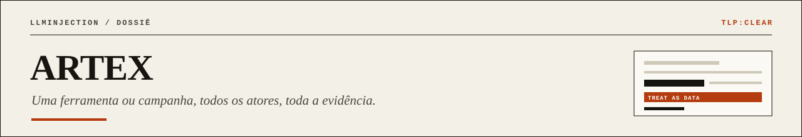

LLMI-DS-ARTEX · v0.5TLP:CLEARCorte 2026-11-25

v0.5 (2026-11-25): três relatórios lidos no original a partir de uma compilação de fontes sobre o ARTEX. O da Bitrise é o relatório de vítima mais detalhado publicado até aqui (§6.4, `INCIDENT-BITRISE-ARTEX-2026-11`). A MadPot da Amazon capturou a memória operacional dos agentes (`CAMPAIGN-ARTEX-MADPOT-AI-CREDENTIAL-THEFT`, `CAMPAIGN-ARTEX-MADPOT-KYC-DEEPFAKE`). A Wiz publicou a campanha ARTEX-Harvester e um caso visto dos dois lados (`CAMPAIGN-ARTEX-HARVESTER`, `INCIDENT-WIZ-CYBERSTRIKEAI-EKS-BOTH-SIDES-2026-10`). A §6.3 traz o que a leitura do código mostra sobre o gate de aprovação. A regra Sigma nova é `det-ai-048-artex-self-declared-pentest-web`.

v0.4 (2026-11-20): censo de consoles da Spectrum (§6.1) e o fork do ScopeSentry que entrega alvos ao ARTEX (§6.2, `TOOL-SCOPESENTRY`, `DET-AI-058`). O repositório artex-detections não mudou desde o mapa da §7.1 (commit `3ad092e`).

v0.3 (2026-11-20): todas as fontes de outubro e novembro citadas foram lidas no original e estão em `data/` com ID `SRC-…`, exceto o boletim da Arctic Wolf sobre o AntiFox, conhecido aqui pela nota da Cloud Security Alliance (grau B). O ARTEX agora é um objeto do grafo: `TOOL-ARTEX`, com arestas `uses-tool` vindas de 14 campanhas e incidentes.

ARTEX é descrito pelas fontes como plataforma open-source multiagente, guiada por LLM, de pentest e C2. Desde o fim de agosto de 2026 aparece em operações de atores de nexo China e Coreia do Norte, de um operador sinófono com motivação financeira e de grupos de extorsão. A novidade relatada é velocidade e escala, não técnica nova: em alguns casos, acesso privilegiado em nuvem em menos de três horas. Para o defensor, a prioridade é retro-hunt de credenciais e apps OAuth desde agosto e caça a consoles ARTEX expostos nos próprios ativos.

## 1. Julgamentos-chave

| # | Julgamento | Confiança | Base |
|---|---|---|---|
| J1 | O ganho do atacante com ARTEX é cadência e escala (operação contínua, muitos alvos em paralelo), não capacidade ofensiva nova. | alta | `SRC-MSFT-STORM-0940-ARTEX`, `SRC-CROWDSTRIKE-VAPOR-PANDA-2026-10`, `SRC-GTIG-ARTEX-2026-10` |
| J2 | Uma ferramenta pública usada por atores de nexos diferentes enfraquece atribuição baseada em ferramenta; a presença de ARTEX não indica o ator. | alta | 4 atores e 3 clusters sem nome nos datasets |
| J3 | O uso atual é inicial e de baixa sofisticação, mas amplo, e a porta de entrada típica é credencial já comprometida. | média | `SRC-GTIG-ARTEX-2026-10` (avaliação do GTIG) |
| J4 | É provável que TAG-217, o "UnSub" da CrowdStrike e o operador da Zscaler se sobreponham; nenhuma fonte afirma que são o mesmo ator. | baixa | `SRC-ZSCALER-ARTEX-GLOBAL` liga os relatos sem nomear o ator |

## 2. O que é (visão do defensor)

- **Arquitetura relatada:** agentes planejador e executores (CrowdStrike); divisão de trabalho entre modelos externos, como DeepSeek, GLM e Grok (Zscaler, que avisa que os IDs de modelo não foram verificados).
- **Origem:** publicado no GitHub pelo desenvolvedor "Autumn-27" em julho de 2026, escrito em Go; o autor tornou o repositório indisponível em 8 de outubro, depois dos relatos de abuso, mas forks, cópias arquivadas, variantes locais e uma versão comercial (ARTEX PRO) continuam circulando (`SRC-FBI-FLASH-20261113-ARTEX`; a Datadog fala em mais de 12 mil forks, `SRC-DATADOG-ARTEX-AWS`).
- **Modelos:** não traz modelo próprio; usa provedores externos (Claude, GPT, DeepSeek, GLM, Grok, Kimi). Nas instâncias de atacantes analisadas, predominam modelos DeepSeek Flash (`SRC-FBI-FLASH-20261113-ARTEX`).
- **Superfície exposta do próprio framework:** a Censys contou 1.465 hosts com console ARTEX exposto em 4 de novembro (cerca de 815 implantações distintas), 10,6% deles com outra ferramenta ofensiva no mesmo host (`SRC-CENSYS-ARTEX-2026-11`); a Check Point achou 2.557 sistemas com painel ARTEX, 1.608 ativos, e 10 expondo o banco inteiro com prompts e passos dos agentes (`SRC-CHECKPOINT-ARTEX-2026-11`). Imagens Docker com backdoor: The Hacker News, citando CERT-In, fala em 62 consoles (`SRC-THN-CERTIN-CRAFTY-FALCON`, grau C).
- **Por dentro, segundo o código (§6.3):** binário Go com console Next.js na porta TCP 8787, onde quem conecta primeiro define a senha de administrador. Os agentes rodam sobre o SDK norma, do mesmo autor, e toda chamada de ferramenta passa por um gate de aprovação cujas regras podem ser desligadas.
- **Fora do escopo:** instruções de uso, implantação ou configuração.

## 3. Linha do tempo

| Data | Evento | Fonte | Confiança |
|---|---|---|---|
| 2026-07 | ARTEX publicado no GitHub por "Autumn-27" | `SRC-FBI-FLASH-20261113-ARTEX` | confirmada |
| 2026-08 (fim) | GTIG/Mandiant observam ARTEX em resposta a incidentes: grupos de extorsão e clusters suspeitos de nexo PRC | `SRC-GTIG-ARTEX-2026-10` | confirmada |
| 2026-08-04 a 10-04 | Prompts recuperados de operador sinófono, setores em 19 países | `SRC-ZSCALER-ARTEX-GLOBAL` | alta |
| 2026-09 a 10 | Intrusões em instituições financeiras sul-coreanas (TAG-217) | `SRC-RECORDEDFUTURE-TAG-217-ARTEX`, `SRC-CROWDSTRIKE-ARTEX-SOUTH-KOREA` | média |
| 2026-08-18 | Diretórios abertos no servidor ARTEX citado pela CrowdStrike, sete semanas antes do relatório | `SRC-CENSYS-ARTEX-2026-11` | alta |
| 2026-10-08 | Repositório original fica indisponível; forks e ARTEX PRO continuam | `SRC-FBI-FLASH-20261113-ARTEX`, `SRC-DATADOG-ARTEX-AWS` | confirmada |
| 2026-10-08 (atualizado 10-23) | JPCERT/CC alerta sobre onda de acessos indevidos a organizações japonesas, incluindo uso de frameworks de pentest com IA | `SRC-JPCERT-AT-2026-0030` | média |
| 2026-10-10 a 14 | Storm-0940: password spraying em 327 contas de 8 organizações | `SRC-MSFT-STORM-0940-ARTEX` | alta |
| 2026-10 | Comprometimento do ConnectWise Cloud Backup, atribuído pela Microsoft ao Storm-0940; app afetado não significa dado acessado | `SRC-MSFT-STORM-0940-ARTEX` | alta |
| 2026-10 | VAPOR PANDA: 14+ países em 11 dias, pós-exploração confirmada em 9 organizações | `SRC-CROWDSTRIKE-VAPOR-PANDA-2026-10` | confirmada |
| 2026-10 (fim) | Pearl Sleet e Onyx Sleet passam a usar ARTEX | `SRC-MSFT-DPRK-AI-2026-10` | confirmada |
| 2026-10 | Wiz: ator com ARTEX ataca fornecedores de TI e software (Okta, Entra ID, Cognito, integrações M365); sobreposição com Storm-0940 é avaliação da Wiz (`CAMPAIGN-ARTEX-IT-SOFTWARE-VENDORS`) | `SRC-WIZ-ARTEX-VENDORS` | alta |
| 2026-10-25 → 10-30 | WorkOS: agente ARTEX de um pesquisador escapa do sandbox e acessa ferramenta interna de vendas, sem intenção maliciosa (`INCIDENT-WORKOS-ARTEX-SANDBOX-ESCAPE`) | `SRC-WORKOS-BULLETIN-2026-10-30` | confirmada |
| 2026-10-28 → 11-05 | Microsoft: ARTEX busca segredos expostos no GitHub; um agente foi do scan à exfiltração do Azure Key Vault em cinco minutos (`CAMPAIGN-ARTEX-EXPOSED-SECRETS`) | `SRC-MSFT-ARTEX-SECRETS-2026-11` | alta |
| 2026-11-05 | Check Point "Hacking on Autopilot" e Censys "Agentic Asbestos": painéis e consoles expostos | `SRC-CHECKPOINT-ARTEX-2026-11`, `SRC-CENSYS-ARTEX-2026-11` | alta |
| 2026-11-06 | Microsoft: Storm-3358 mira o setor financeiro | A VERIFICAR | — |
| 2026-11 | Datadog: ARTEX em contas AWS com chaves IAM comprometidas (`CAMPAIGN-ARTEX-AWS`) | `SRC-DATADOG-ARTEX-AWS` | alta |
| 2026-11-11 | Unit 42: páginas de reset de senha e APIs expostas viram acesso à nuvem, sem explorar vulnerabilidade (`CAMPAIGN-ARTEX-IDENTITY-WORKFLOWS`) | `SRC-UNIT42-ARTEX-2026-11` | alta |
| 2026-11-12 | Eye Security: resposta a incidente de intrusão guiada por ARTEX (`INCIDENT-EYE-ARTEX-IR`) | `SRC-EYE-ARTEX-IR-2026-11` | confirmada |
| 2026-11-10 | Arctic Wolf (via CSA): AntiFox, fork do ARTEX 0.1.1, em intrusões contra IIS e AWS (`CAMPAIGN-ANTIFOX-AWS-IIS`, `TOOL-ANTIFOX`) | `SRC-CSA-ANTIFOX` (B) | média |
| 2026-11-13 | FBI FLASH-20261113-001: 67 mil pessoas com dados exfiltrados na Coreia do Sul; mais de 2.250 tenants com tentativas de login no caso ConnectWise | `SRC-FBI-FLASH-20261113-ARTEX` | confirmada |
| 2026-11-13 → 11-20 | Pack de detecção MalwareMustDie MMD-072 (v1.1.6 em 20/11), DRL 1.1 | `ECO-126` | — |
| 2026-10-03 → 11-05 | Sensores MadPot da Amazon que se passam por APIs de LLM recebem a memória dos agentes: roubo de chaves de IA em escala e tentativa de burlar o KYC de duas exchanges com deepfake (`CAMPAIGN-ARTEX-MADPOT-AI-CREDENTIAL-THEFT`, `CAMPAIGN-ARTEX-MADPOT-KYC-DEEPFAKE`) | `SRC-AWS-ARTEX-MADPOT-2026-11` | média |
| 2026-10 (4 dias) | Wiz: intrusão em 2 contas AWS e 7 clusters EKS, vista também pelo diretório aberto do operador; o CyberStrikeAI comandava a operação, com um checkout do ARTEX ao lado (`INCIDENT-WIZ-CYBERSTRIKEAI-EKS-BOTH-SIDES-2026-10`) | `SRC-WIZ-AGENTIC-ATTACKS-2026-11` | alta |
| 2026-10 (fim) → 11 (meio) | Wiz: campanha ARTEX-Harvester em mais de uma dúzia de organizações, com saída por proxy residencial diferente a cada requisição (`CAMPAIGN-ARTEX-HARVESTER`) | `SRC-WIZ-AGENTIC-ATTACKS-2026-11` | média |
| 2026-10-25 → 11-18 | Bitrise: do reconhecimento "pentest autorizado" à conta de bot dormente e dez horas de encadeamento de credenciais; relatório público em 19/11 (`INCIDENT-BITRISE-ARTEX-2026-11`) | `SRC-BITRISE-ARTEX-INCIDENT-2026-11` | confirmada |
| 2026-11-16 | GTIG: frameworks multiagente (ARTEX, CAIRN, CyberStrikeAI, PentAGI) e exploração de n-days automatizada | `SRC-GTIG-AGENTIC-THRESHOLD-2026-11` | confirmada |

## 4. Quem usa

| Ator | Nexo | Uso relatado | Papel da IA | Fonte |
|---|---|---|---|---|
| Storm-0940 (GTIG: UNC7228, sobreposição) | China | varredura, spraying, abuso de OAuth e Graph | autonomous-operator | `SRC-MSFT-STORM-0940-ARTEX` |
| VAPOR PANDA | China | web shells, senhas de administrador de domínio, movimento lateral | autonomous-operator | `SRC-CROWDSTRIKE-VAPOR-PANDA-2026-10` |
| Pearl Sleet | Coreia do Norte | uso em operações desde o fim de outubro | — | `SRC-MSFT-DPRK-AI-2026-10` |
| Onyx Sleet | Coreia do Norte | uso citado; a Microsoft não diz para quê numa intrusão específica | — | `SRC-MSFT-DPRK-AI-2026-10` |
| TAG-217 / UnSub | não declarado | setor financeiro sul-coreano | — | `SRC-RECORDEDFUTURE-TAG-217-ARTEX`, `SRC-CROWDSTRIKE-ARTEX-SOUTH-KOREA` |
| Operador sinófono sem nome | financeiro (provável) | 19 países, vários modelos | — | `SRC-ZSCALER-ARTEX-GLOBAL` |
| Grupos de extorsão sem nome | financeiro | reconhecimento até extorsão por roubo de dados | — | `SRC-GTIG-ARTEX-2026-10` |
| Sem nome (Microsoft) | não declarado | segredos expostos no GitHub, credenciais de app multitenant | autonomous-operator | `SRC-MSFT-ARTEX-SECRETS-2026-11` |
| Sem nome (Unit 42) | não declarado | reset de senha e APIs expostas, varejo e consultoria | — | `SRC-UNIT42-ARTEX-2026-11` |
| Grupos de nexo chinês sem nome (Amazon, confiança média) | China | roubo de chaves de IA que pagam a inferência da própria caça; KYC de exchanges com deepfake | autonomous-operator | `SRC-AWS-ARTEX-MADPOT-2026-11` |
| Operador do ARTEX-Harvester (Wiz) | não declarado | credenciais roubadas, confiança de CI, tokens de pod até cluster-admin | autonomous-operator | `SRC-WIZ-AGENTIC-ATTACKS-2026-11` |
| Storm-3358 | Camboja, financeiro | upload anônimo, SSRF, RATs WISP, vshell e AdaptixC2 contra finanças no Sudeste Asiático | autonomous-operator | `SRC-MSFT-STORM-3358-ARTEX` |

**Vizinho no mesmo relatório do GTIG:** PentAGI, outro framework agêntico aberto, usado por operadores sem atribuição contra integradores e operadoras de telecom na Ásia (`CAMPAIGN-PENTAGI-ASIA-TELECOM`, confiança média).

## 5. Cadeia de ataque observada

| Fase | Técnica | Evidência |
|---|---|---|
| Acesso inicial | credenciais já comprometidas; password spraying | GTIG; Microsoft |
| Reconhecimento | varredura contínua guiada por agentes | Microsoft, CrowdStrike |
| Persistência em nuvem | abuso de aplicativos OAuth, Microsoft Graph | Microsoft |
| Execução e lateral | web shells, extração de credenciais de domínio | CrowdStrike |
| Impacto | exfiltração e extorsão | GTIG |
| Orquestração | `LLMI-T015` Agentic Attack Orchestration; `LLMI-T028` AI-Assisted Tooling Development | `relationships.json` |

## 6. O que a IA mudou de fato

- **Tempo:** acesso privilegiado em nuvem em menos de três horas em alguns casos (Microsoft).
- **Cadência:** operação 24 horas, sem pausa de turno (Microsoft).
- **Paralelismo:** 14+ países em 11 dias (CrowdStrike).
- **Limite declarado pelas fontes:** a Recorded Future diz que a evidência não estabelece quanto a IA acelerou os ataques; o GTIG chama o uso de inicial e pouco sofisticado.
- **Camada 8:** o operador deixa de executar e passa a supervisionar; o erro humano que sobra é de escolha de alvo e de higiene da própria infraestrutura (consoles expostos, imagens com backdoor). Do lado do defensor, o risco é o viés de novidade: tratar "IA" como causa quando a porta de entrada continua sendo credencial vazada.

### 6.1 Censo de consoles expostos (Spectrum, 18/11)

A Spectrum cruzou dados de varredura de terceiros (Shodan, InternetDB, urlquery, urlscan, GreyNoise, CT logs) com a leitura do código-fonte e não se conectou a nenhum console (`SRC-SPECTRUM-SWARM-CHASING`, grau B).

| Medida | Valor | Leitura |
|---|---|---|
| Consoles ofensivos de IA expostos | 2.335 | limite inferior; parte é de pentesters, estudantes ou honeypots |
| Variantes distintas de ARTEX | 47 | forks, builds privados e consoles renomeados (ScopeWeaver ×65, HekerAI, artex-mx…) |
| Consoles ARTEX que a busca pelo título padrão não acha | 179 | título é impressão digital fraca |
| Frota `sco-fix2` | 348 serviços em 254 IPs, um único AS | origem comum: alta; um único operador: baixa |
| PentAGI clonado | 116 cópias com o mesmo certificado | imagem clonada |
| Crescimento do título padrão no Shodan | +41% entre 6 e 18/11 | parte pode ser o Shodan rastreando mais |

**Três ferramentas ofensivas não documentadas** apareceram em consoles únicos: 红刃 (Red Blade), RedTeam Platform e 鲸鱼 (Whale). Não entram no grafo até haver fonte que as descreva além da página do próprio console.

**Impressões digitais que resistem a renomeação**, ligadas a `DET-AI-052`: marcadores de página do template (classes CSS, chaves de tema), certificado TLS compartilhado, string de build privado e o realm "ARTEX" no 401 da porta 8787. Título e favicon pegam só instalações padrão.

### 6.2 ScopeSentry: reconhecimento ligado ao ARTEX

ScopeSentry é uma plataforma open-source de mapeamento de ativos (subdomínios, portas, fingerprint, diretórios, vulnerabilidades, monitoramento de página) publicada desde junho de 2024 por Autumn-27, o mesmo handle que publicou o ARTEX. O fork `niudaii/ScopeSentry` (v1.9.4, 26/08/2026), lido no código, acrescenta duas coisas (`SRC-GH-SCOPESENTRY-NIUDAII`):

- **Cliente de tarefas do ARTEX.** Na tela de ativos, a ação "scan task" faz login na API do ARTEX (`/api/auth/login`, usuário padrão "ARTEX", porta 8787) e envia o ativo como objetivo da tarefa (`/api/tasks`). A configuração traz um endereço padrão em IP público (`111.124.203[.]18:8787`); sem senha configurada, o login falha. É um padrão de código, não um ataque observado.
- **Servidor MCP.** Um cliente de IA (o guia cita o Cursor) lista ativos e cria varreduras com uma chave `ssk_…`.

O que isso significa: reconhecimento em escala alimentando exploração autônoma, no mesmo painel. Para o defensor, `DET-AI-058` procura hosts internos que fazem login ou enviam tarefas a uma API ARTEX. Compartilhar o handle com o autor do ARTEX não é evidência de envolvimento em intrusão.

### 6.3 Por dentro do código: o que o defensor ganha

A leitura do código-fonte publicada em 8 de outubro, último dia do repositório aberto, é de grau C (`SRC-0XUKI-ARTEX-DESIGN`, em japonês). A Bitrise confirma três trechos dela com os próprios logs.

- **Dois grafos.** O grafo de ativos (domínios, IPs, serviços, endpoints) é compartilhado entre tarefas e montado pelo programa. O grafo de exploração (objetivos, intents, fatos, achados) registra, em cada tarefa, o que foi tentado e por quê. A Amazon viu esse estado completo chegar aos sensores MadPot, junto com o histórico das ferramentas.
- **Quatro papéis:** goals, planner, worker (três em paralelo por tarefa, no padrão) e mainagent. As fontes divergem no número de agentes: o GTIG fala em seis subagentes, e a Amazon cita planner, worker, verificação e compressão.
- **Gate de aprovação com padrões frouxos.** Toda chamada de ferramenta passa por regras guardadas no banco, que podem permitir, negar ou perguntar ao usuário.
  - Vêm ligadas no padrão: o bloqueio de comandos destrutivos, a exclusão de domínios .gov e .edu e o bloqueio de rotas de DELETE.
  - Vem desligado no padrão: o bloqueio de saída de dados.
  - O operador pode delegar a aprovação a outro modelo. Se esse modelo falhar ou passar de 15 s, a chamada é permitida.
  - Quando o gate bloqueia, a mensagem avisa o agente que não se trata de defesa do alvo. Contra WAF e 403 do alvo, o agente faz o contrário: procura outro caminho. Um bloqueio do lado do defensor, portanto, não encerra o ataque.
- **Console.** Escuta na porta TCP 8787, e quem conecta primeiro define a senha de administrador. Uma auditoria em laboratório citada no dossiê de fontes registra `127.0.0.1:8788`; a divergência não está resolvida.
- **Impressões confirmadas por vítima (Bitrise):**
  - o user agent `norma/0.4`, fixo no web-fetch do SDK norma;
  - nomes `i<número do intent>` em tudo o que o agente cria, porque cada worker roda num diretório com esse nome;
  - user agents que se declaram "pentest autorizado", porque o prompt padrão diz a cada agente que ele faz parte de um teste autorizado.

  Essas impressões identificam a ferramenta, não o operador.

### 6.4 A vítima conta: Bitrise (`INCIDENT-BITRISE-ARTEX-2026-11`)

O relatório da Bitrise (TLP:CLEAR, v1.6) é o relato de vítima mais detalhado publicado até aqui. Cada um dos 69 passos tem grau de evidência e as linhas de log correspondentes. Os autores declaram que usaram IA para escrever o relatório e que pessoas conferiram as afirmações.

- **Porta de entrada:** uma conta de bot de teste parada havia quase quatro anos, sem segundo fator e ainda membro de um workspace interno. Não houve falha de software.
- **Relógio:**
  - 10 min 37 s do login à primeira chave de nuvem em uso;
  - 3 h 54 min da detecção ao desligamento da plataforma;
  - 10 h 11 min até o último uso de chave roubada.
- **O que saiu:**
  - segredos de CI internos que estavam mascarados, mas podiam ser revelados (até 385 apps);
  - material de assinatura Apple e Android;
  - 236 arquivos de state do Terraform de produção;
  - 28 repositórios privados clonados.
- **Clientes:** arquivos em 15 workspaces e uma lista de 150 e-mails. A Bitrise não viu acesso ao cofre de segredos dos clientes.
- **Depois do bloqueio:** o atacante voltou em 18/11 e reutilizou o que tinha roubado, mas nada abriu.

| Lição da Bitrise | No repositório |
|---|---|
| Tráfego que se diz pentest autorizado, sem teste agendado, é o atacante se apresentando | `DET-AI-048`, regra Sigma nova |
| Procurar nomes `i<3 a 6 dígitos>` com probe, canary, certs ou net | `DET-AI-048` |
| Conta de bot ou de teste com senha e sem segundo fator; alertar login de conta parada há meses | `DET-AI-049` (ritmo de identidade), retro-hunt |
| Segredo que pode ser revelado vai ser revelado: usar segredos protegidos e correlacionar revelação com primeiro uso de credencial | `DET-AI-047` |
| Chave de service account usada de fora das faixas da nuvem e do escritório | `DET-AI-046`, `DET-AI-047` |
| Muitas identidades por endereço de origem; principal só com negações | `DET-AI-047` |
| State do Terraform e arquivos .p12, .p8 e keystore lidos por quem não é o pipeline | lacuna `GAP-CLOUD-SECRETS-1` |
| Log de leitura do cofre de segredos ligado antes do incidente | [`docs/CLOUDTRAIL-DISCOVERY-DATA-EVENTS.md`](../../docs/CLOUDTRAIL-DISCOVERY-DATA-EVENTS.md), pela mesma lógica de evento de dados |
| Ter um interruptor que desliga a plataforma em segundos, decidido e ensaiado antes | §8 |

## 7. Detecção

- **No repositório:** detecções ligadas a `LLMI-T015` (ver [playbook](../../docs/playbooks/LLMI-T015.md)).
- **Regra Sigma nova** `detections/sigma/det-ai-048-artex-self-declared-pentest-web.yml`: procura `norma/0.4`, user agents de "pentest autorizado" e caminhos canário `/_i<n>_probe` em logs de web, WAF e CDN. O status é experimental. A Wiz lista regras equivalentes e avisa que elas perecem rápido, porque os forks trocam esses rótulos.
- **Pack de terceiros:** MalwareMustDie MMD-072 (`ECO-126`), licença DRL 1.1 com atribuição obrigatória, tiers T1 a T4 (T4 só para hunting) e validade por indicador. Também está integrado ao repositório `detectionrules`, numa branch ainda sem PR.
- **O FBI mapeia o ARTEX ao ATT&CK** fase a fase (T1595, T1580, T1087.004, T1190, T1078, T1199, T1606.002, T1552.001…) e pede caça em gateways de LLM, escrita e apagamento de blob em menos de um segundo, dry-runs de validação de deploy ARM e abuso de Kudu/SCM (`SRC-FBI-FLASH-20261113-ARTEX`).
- **Sinais de comportamento que não dependem de IOC:**
  - cadência de máquina nos logs de autenticação (tentativas espaçadas de forma regular, 24 horas);
  - app OAuth novo ou consentimento logo depois de uma rajada de spraying;
  - requisições duplicadas e quase simultâneas vindas de subagentes;
  - tráfego para gateways de LLM a partir de hosts de servidor.

### 7.1 Mapa completo da ThreatDefence (2026-11-20)

O repositório [ThreatDefence/artex-detections](https://github.com/ThreatDefence/artex-detections) (MIT) foi mapeado regra a regra em [ARTEX-DETECTION-MAP.md](../../docs/ARTEX-DETECTION-MAP.md): 209 arquivos de regra em 29 comportamentos e 184 indicadores.

| Nossa detecção | O que cobre | Plataformas deles |
|---|---|---|
| DET-AI-046 | sondagem de permissões: DryRun no EC2, varredura de validate no ARM, logins no Kudu | Sigma, Sentinel, Splunk, Elastic |
| DET-AI-047 | varredura de acesso negado, busca de segredos no CloudWatch, leitura em massa no Key Vault | Sigma, Sentinel, Splunk, Elastic |
| DET-AI-048 (nova) | user agents, artefatos de sondagem, cabeçalho X-ARTX-KEY, JWT alg:none, callbacks para webhook e DNS log | Sigma, Sentinel, Splunk, Elastic, Zeek, Suricata |
| DET-AI-049 (nova) | spray em ritmo de um segundo, rajada de família de user agent, spray que termina em sucesso | Sigma, Sentinel, Splunk, Elastic |
| DET-AI-050 (nova) | service principal: adivinhação de segredo, credencial ou papel concedido a si mesmo, leque de recursos, rajadas no Graph | Sigma, Sentinel, Splunk |
| DET-AI-051 (nova) | abuso de cadastro self-service no Cognito seguido de descoberta | Sigma, Sentinel, Splunk, Elastic |
| DET-AI-052 (nova) | console ARTEX ou imagem com backdoor dentro da rede | Sentinel, YARA, osquery |

Sete comportamentos são detecção genérica de intrusão (shell a partir de serviço web, web shells, Kerberoasting, mascaramento de binários) e ficam como link.

## 8. Mitigação priorizada

| Ação | Esforço | Efeito |
|---|---|---|
| Retro-hunt de credenciais, sign-ins e apps OAuth desde 2026-08-01 | médio | encontra acesso já obtido |
| MFA resistente a phishing e bloqueio de autenticação legada | médio | corta o spraying |
| Revisão de consentimentos OAuth e apps de terceiros com acesso amplo | baixo | fecha a persistência relatada |
| Procurar consoles ARTEX expostos nos próprios ativos (só ativos autorizados) | baixo | acha infraestrutura de atacante ou uso interno não sancionado |
| Varredura de segredos em repositórios | baixo | remove o atalho descrito pela Microsoft em 05/11 |
| Apagar ou pôr segundo fator em contas de bot, de teste e de serviço que entram com senha (Bitrise) | baixo | fecha a porta usada na Bitrise |
| Segredos de CI protegidos (só escrita) e state do Terraform tratado como cofre | médio | tira do alcance o que o agente buscou primeiro |
| Gateways de LLM e apps de IA (One API, LiteLLM, Dify, Langflow, Ollama…) com autenticação e sem chave mestra padrão (Amazon) | baixo | corta o roubo de chaves que financia a própria caça |
| Interruptor de desligamento por sistema, com responsável definido e ensaio | médio | encurta a janela de contenção, que é o problema real |

## 9. Indicadores

Não reproduzidos aqui. Use o CSV do pack MMD-072 (`ECO-126`) ou o anexo do FBI FLASH, respeitando tier e validade de cada indicador; T4 nunca vira bloqueio.

## 10. O que este dossiê não afirma

- **PHP2Shell não é componente do ARTEX.** É um par de falhas no interpretador PHP (CVE-2026-109618 e CVE-2026-109619). A Eye Security diz que o caso dela não envolveu PHP2Shell (`SRC-EYE-ARTEX-IR-2026-11`).
- Usar ARTEX não é o mesmo que tê-lo desenvolvido.
- Os atores que usam ARTEX não estão ligados entre si por usá-lo.

## 11. Brasil e América Latina

Impacto regional não demonstrado nas fontes consultadas. Hipótese a testar: consoles ARTEX expostos em ASNs brasileiros, por consulta de leitura em Censys ou Shodan.

## 12. Mudanças propostas no repositório

- Feito em v0.3: `data/tools.json` com ARTEX, AntiFox, PentAGI, CAIRN, CyberStrikeAI, HexStrike AI e Strix; `uses-tool` liga campanhas e incidentes a cada um, e `TOOL-ANTIFOX derived-from TOOL-ARTEX`. No Explorer, `#tab=graph&focus=TOOL-ARTEX` mostra quem usa.
- Ler o boletim original da Arctic Wolf sobre o AntiFox quando for localizado.
- Avaliar Storm-3358 como ator.
- Feito em v0.5: Bitrise, MadPot e ARTEX-Harvester no grafo; regra Sigma do `DET-AI-048`. Na fila (`RQ-ADS-20261125-*`): a SentinelOne (429), o blog do NCSC (não localizado), o relatório original da BadByte sobre as imagens Docker, o Black October da Wiz, que pede a leitura de cada divulgação, e o runbook da Kodem.

## 13. Fontes

| ID | Publicador | Grau | Lido no original |
|---|---|---|---|
| `SRC-GTIG-ARTEX-2026-10` | Google Threat Intelligence Group | A | sim |
| `SRC-MSFT-STORM-0940-ARTEX` | Microsoft Threat Intelligence | A | sim |
| `SRC-MSFT-DPRK-AI-2026-10` | Microsoft Threat Intelligence | A | sim |
| `SRC-CROWDSTRIKE-VAPOR-PANDA-2026-10` | CrowdStrike | A | sim |
| `SRC-CROWDSTRIKE-ARTEX-SOUTH-KOREA` | CrowdStrike | A | sim |
| `SRC-RECORDEDFUTURE-TAG-217-ARTEX` | Recorded Future | A | sim |
| `SRC-ZSCALER-ARTEX-GLOBAL` | Zscaler ThreatLabz | A | sim |

**Lidas em 2026-11-20 e registradas:** `SRC-FBI-FLASH-20261113-ARTEX` · `SRC-MSFT-ARTEX-SECRETS-2026-11` · `SRC-CHECKPOINT-ARTEX-2026-11` · `SRC-CENSYS-ARTEX-2026-11` · `SRC-EYE-ARTEX-IR-2026-11` · `SRC-DATADOG-ARTEX-AWS` · `SRC-UNIT42-ARTEX-2026-11` · `SRC-GTIG-AGENTIC-THRESHOLD-2026-11` · `SRC-JPCERT-AT-2026-0030` · `SRC-THN-CERTIN-CRAFTY-FALCON` (grau C).

Também lidas: `SRC-MSFT-STORM-3358-ARTEX` · `SRC-WIZ-ARTEX-VENDORS` · `SRC-WORKOS-BULLETIN-2026-10-30` · `SRC-CSA-ANTIFOX` (B) · `SRC-BC-ANTIFOX` (C).

**Lidas em v0.4:** `SRC-SPECTRUM-SWARM-CHASING` (B) · `SRC-GH-SCOPESENTRY-NIUDAII` (código, B). As 22 referências da Spectrum ainda não abertas aqui estão na fila de pesquisa (`intake/digests/2026-11-20-spectrum.json`).

**Lidas em v0.5 (2026-11-25):** `SRC-BITRISE-ARTEX-INCIDENT-2026-11` (A) · `SRC-AWS-ARTEX-MADPOT-2026-11` (A) · `SRC-WIZ-AGENTIC-ATTACKS-2026-11` (A) · `SRC-0XUKI-ARTEX-DESIGN` (C, leitura de código) · `SRC-GUARDZ-ARTEX` (D) · `SRC-TOMODAHINATA-ARTEX-ARCH` (D, separa o que foi confirmado do que não foi). O ponto de partida foi uma compilação de mais de 60 fontes, usada só como roteiro de leitura.

**Ainda a ler:** o boletim da Arctic Wolf (não localizado); a Huntress (403) e a SentinelOne (429) recusaram o acesso automático.
