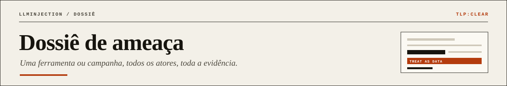

LLMI-PA-STORM-0940 · v0.1TLP:CLEARCorte 2026-11-21

Primeiro perfil de ator do repositório, escrito sobre o modelo `reports/templates/perfil-de-ator.md`. Tudo o que está aqui vem dos registros `ACTOR-STORM-0940` e `CAMPAIGN-STORM-0940-ARTEX-CONNECTWISE` e das fontes listadas na seção 10. O contexto da ferramenta está no [dossiê ARTEX](artex.md).

Storm-0940 é o nome da Microsoft para um ator alinhado ao Estado chinês, ativo desde 2021. Em setembro e outubro de 2026 ele entregou a um framework agêntico público, o ARTEX, o trabalho repetitivo de uma intrusão em identidade e nuvem: varredura, password spraying e abuso de aplicações OAuth, sem pausa. A Microsoft avalia que o mesmo ator está por trás do comprometimento do ConnectWise Cloud Backup. Para o defensor, a técnica é conhecida; o que muda é o relógio: em alguns casos, menos de três horas entre o primeiro acesso e o privilégio em nuvem.

## 1. Identidade

| Campo | Valor | Fonte |
|---|---|---|
| Nome principal | Storm-0940 | `SRC-MSFT-STORM-0940-ARTEX` |
| Apelidos (por fornecedor) | UNC7228 (GTIG), descrito como atividade que se sobrepõe à do Storm-0940. A Wiz não dá nome próprio: diz que o que observou se sobrepõe ao relato da Microsoft. | `SRC-GTIG-ARTEX-2026-10`, `SRC-WIZ-ARTEX-VENDORS` |
| Nexo ou motivação | China, alinhado ao Estado (avaliação da Microsoft) | `SRC-MSFT-STORM-0940-ARTEX` |
| Ativo desde | 2021 | `SRC-MSFT-STORM-0940-ARTEX` |
| Registro no grafo | `ACTOR-STORM-0940` | – |
| Confiança da atribuição | confirmada para o uso de ARTEX pelo ator; alta para a autoria do caso ConnectWise | Microsoft observou a atividade em sua telemetria; a autoria do caso ConnectWise é avaliação da Microsoft, não confirmação de terceiros |

"Storm" é o prefixo que a Microsoft usa para grupos ainda em desenvolvimento: o nome pode mudar se o ator for promovido a um nome definitivo.

## 2. Modelo Diamond

| Vértice | O que as fontes dizem |
|---|---|
| Adversário | Ator alinhado ao Estado chinês, ativo desde 2021. As fontes lidas não nomeiam patrocinador, unidade ou operadores. |
| Capacidade | ARTEX (`TOOL-ARTEX`), framework open-source multiagente de pentest, usado para varredura, password spraying e abuso de aplicações OAuth em operação contínua. Atividade posterior acelerada por IA via Microsoft Graph. Nenhum modelo de IA específico é atribuído ao ator nos registros. |
| Infraestrutura | Não detalhada nos registros do repositório. A Censys mede consoles ARTEX expostos na internet, mas a contagem é da ferramenta, não deste ator. |
| Vítima | Identidade e nuvem corporativa: 327 contas em oito organizações num único período de cinco dias; clientes do ConnectWise Cloud Backup (centenas de organizações, segundo a Microsoft; mais de 2.250 tenants com tentativas de login, segundo o FBI). A Wiz relata alvos entre fornecedores de TI e software. |

## 3. Papel da IA

Classificação no repositório: `autonomous-operator`.

**Demonstrado.** O ARTEX executou sozinho as etapas de volume: varrer, testar senhas em cadência fixa e abusar de consentimento OAuth, 24 horas por dia. A Microsoft também observou atividade pós-acesso acelerada por IA no Microsoft Graph.

**Não demonstrado.** Nenhuma fonte descreve técnica ofensiva nova, descoberta de vulnerabilidade por IA ou operação sem operador humano do início ao fim. O ganho relatado é cadência e escala (julgamento J1 do dossiê ARTEX).

## 4. Campanhas e incidentes

| Data | Campanha ou incidente | Ferramentas | Confiança | Fonte |
|---|---|---|---|---|
| 2026-09 a 2026-10 | Ataques automatizados com ARTEX: varredura, spraying e abuso de OAuth (`CAMPAIGN-STORM-0940-ARTEX-CONNECTWISE`) | ARTEX | alta | `SRC-MSFT-STORM-0940-ARTEX` |
| 2026-10-10 a 14 | Password spraying contra 327 contas de oito organizações | ARTEX | alta | `SRC-MSFT-STORM-0940-ARTEX` |
| 2026-10 | Comprometimento do ConnectWise Cloud Backup, com efeito sobre tenants de clientes | ARTEX | alta | `SRC-MSFT-STORM-0940-ARTEX` |
| 2026-10 | Ator com ARTEX contra fornecedores de TI e software: Okta, Entra ID, Cognito e integrações do Microsoft 365 (`CAMPAIGN-ARTEX-IT-SOFTWARE-VENDORS`). Sobreposição com Storm-0940 é avaliação da Wiz; sem aresta de ator no grafo. | ARTEX | média (para o vínculo) | `SRC-WIZ-ARTEX-VENDORS` |
| 2026-11-13 | FBI FLASH-20261113-001: mais de 2.250 tenants com tentativas de login no caso ConnectWise | – | confirmada | `SRC-FBI-FLASH-20261113-ARTEX` |

## 5. TTPs

A coluna ATT&CK é mapeamento do analista sobre o comportamento descrito; as fontes não publicam essa tabela.

| Fase | Técnica (LLMI-T / ATT&CK) | Evidência |
|---|---|---|
| Reconhecimento | `LLMI-T015` Orquestração agêntica de ataque · T1595 Active Scanning | Varredura contínua conduzida pelo ARTEX |
| Acesso a credenciais | `LLMI-T015` · T1110.003 Password Spraying | 327 contas, oito organizações, 10 a 14 de outubro |
| Acesso inicial | T1078.004 Valid Accounts: Cloud Accounts | Porta de entrada é conta válida obtida no spraying |
| Persistência e escalada | T1528 Steal Application Access Token · abuso de aplicação OAuth | Abuso de OAuth relatado pela Microsoft; privilégio em nuvem em menos de três horas em alguns casos |
| Coleta | Consultas ao Microsoft Graph aceleradas por IA | Atividade posterior observada pela Microsoft |
| Cadeia de suprimentos | T1195 Supply Chain Compromise · T1199 Trusted Relationship | ConnectWise Cloud Backup como ponte para tenants de clientes |

## 6. Como detectar

A detecção que funciona aqui olha para ritmo, não para assinatura da ferramenta: o ARTEX é público e pode ser trocado.

| Detecção | Sinal de comportamento | Regra pronta |
|---|---|---|
| `DET-AI-049` | Ataque de identidade em cadência de máquina: spraying em ritmo fixo, rajada de variantes de user agent | – |
| `DET-AI-050` | Abuso de service principal depois do acesso: adivinhação de segredo, papel concedido a si mesmo, leque de recursos | – |
| `DET-AI-046` | Sondagem de permissões em nuvem em intervalos abaixo de um segundo | KQL: `detections/sentinel/det-ai-046-subsecond-cloud-permission-probe.kql` |
| `DET-AI-047` | Rajada de chamadas negadas em vários serviços, seguida de um sucesso | KQL e SPL: `det-ai-047-denied-burst-then-success` |
| `DET-AI-048` | Impressões de framework ofensivo agêntico: user agents, artefatos de sonda, serviços de retorno | – |
| `DET-AI-051` | Cadastro self-service abusado, seguido de descoberta | – |

Hipótese de hunting: *um mesmo principal passa de primeiro login bem-sucedido a consentimento de aplicação ou papel privilegiado em menos de três horas, fora do horário habitual do titular.* Quem tem ConnectWise Cloud Backup no ambiente deve rever consentimentos e credenciais de aplicação criados em outubro de 2026.

**Lacuna de telemetria confirmada em emulação.** A Mitigant emulou as técnicas do Storm-0940 via ARTEX numa conta AWS e viu a enumeração de filas SQS passar sem registro no CloudTrail (demo de 2026-11-22, grau C). O motivo é documentado pela AWS: `ListQueues`, `GetQueueAttributes`, `GetQueueUrl` e `ListQueueTags` são eventos de dados, que a trilha não grava por padrão. Sem esse registro, a rajada que o `DET-AI-047` procura fica incompleta. Como ligar só esses eventos está em [`docs/CLOUDTRAIL-DISCOVERY-DATA-EVENTS.md`](../../docs/CLOUDTRAIL-DISCOVERY-DATA-EVENTS.md).

## 7. Camada 8

Leitura do analista, não fato de fonte.

**Padrão de decisão do operador.** Delegar o trabalho de volume a um agente e reservar a atenção humana para o alvo que rende: a ponte de cadeia de suprimentos. A escolha de uma ferramenta pública em vez de ferramenta própria reduz custo e dilui atribuição, e é coerente com um ator que quer escala.

**Gatilho explorado nas vítimas.** Não é engano de pessoa; é hábito de operação. Senhas fracas reutilizadas, consentimento OAuth aprovado sem revisão e confiança implícita no fornecedor de backup. O intervalo de três horas cabe dentro de um turno sem ninguém olhando o alerta, e o SOC calibrado para a velocidade de um operador humano tende a descartar o início da sequência como ruído.

## 8. O que não se afirma

- Que UNC7228 e Storm-0940 sejam o mesmo grupo. As fontes falam em sobreposição de atividade.
- Que a campanha descrita pela Wiz seja do Storm-0940. A sobreposição é avaliação da Wiz, e por isso não há aresta de ator no grafo.
- Que dados tenham sido acessados em todo tenant afetado. A Microsoft diz que aplicação afetada não significa dado acessado.
- Que a presença de ARTEX indique este ator. A ferramenta aparece com pelo menos quatro atores e três clusters sem nome nos datasets.
- Que o ator tenha desenvolvido ou modificado o ARTEX.
- Os 67 mil afetados na Coreia do Sul citados no mesmo FLASH do FBI não são atribuídos aqui ao Storm-0940.

## 9. Brasil e América Latina

Impacto regional não demonstrado nas fontes consultadas. A Microsoft fala em tenants afetados em todo o mundo, sem lista por país. O risco regional é indireto: provedores de serviços gerenciados e clientes que usam ConnectWise Cloud Backup.

## 10. Fontes e retroalimentação

| ID | Publicador | Grau | Data |
|---|---|---|---|
| [`SRC-MSFT-STORM-0940-ARTEX`](https://www.microsoft.com/en-us/security/blog/2026/10/21/storm-0940-uses-artex-agentic-ai-connectwise-supply-chain-compromise/) | Microsoft Threat Intelligence | A | 2026-10-21 |
| [`SRC-WIZ-ARTEX-VENDORS`](https://www.wiz.io/blog/artex-in-the-wild-storm-0940-expands-targeting-of-it-and-software-vendors) | Wiz Research | A | 2026-10-22 |
| [`SRC-GTIG-ARTEX-2026-10`](https://cloud.google.com/blog/topics/threat-intelligence/artex-and-friends-enter-agentic-offensive-frameworks) | Google Threat Intelligence Group | A | 2026-10-30 |
| [`SRC-CENSYS-ARTEX-2026-11`](https://censys.com/blog/artex-agentic-asbestos) | Censys | A | 2026-11-05 |
| [`SRC-FBI-FLASH-20261113-ARTEX`](https://www.ic3.gov/CSA/2026/261113.pdf) | FBI | A | 2026-11-13 |
| [`SRC-AWS-SQS-CLOUDTRAIL-LOGGING`](https://docs.aws.amazon.com/AWSSimpleQueueService/latest/SQSDeveloperGuide/sqs-logging-using-cloudtrail.html) | Amazon Web Services | A | documentação, lida em 2026-11-23 |
| [`SRC-MITIGANT-ARTEX-KIRO-MCP`](https://www.youtube.com/watch?v=nLj5LP7oKT0) | Mitigant | C | 2026-11-22 |

Lacunas para a v0.2: infraestrutura do ator, setores e países das oito organizações, atividade anterior a 2026, e se a Microsoft promove o nome "Storm".

Próxima revisão: 2026-12-19, ou antes se a Microsoft ou o GTIG publicarem atualização.
