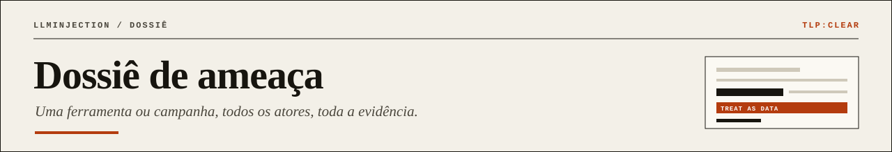
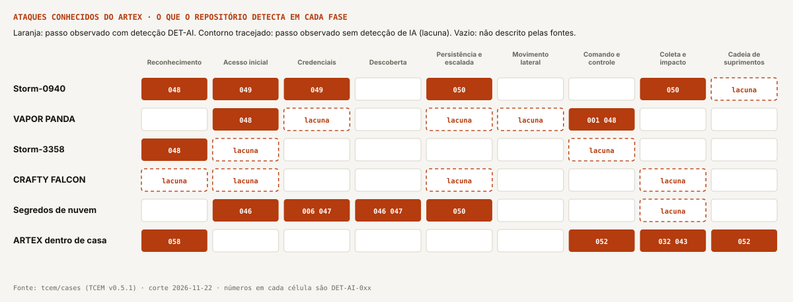
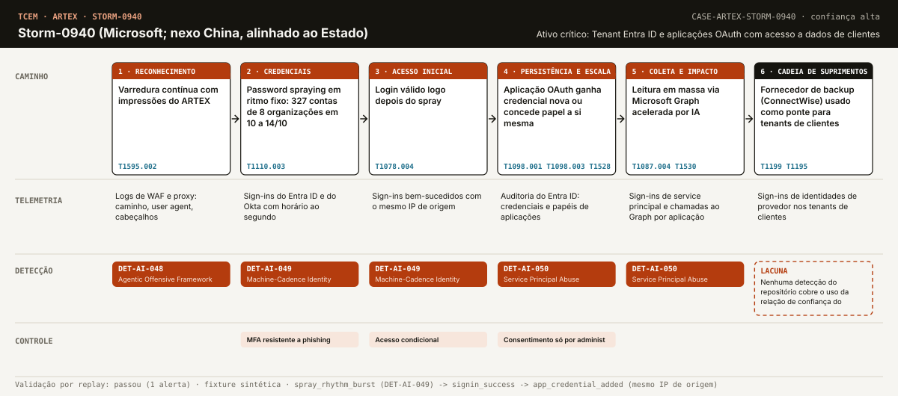
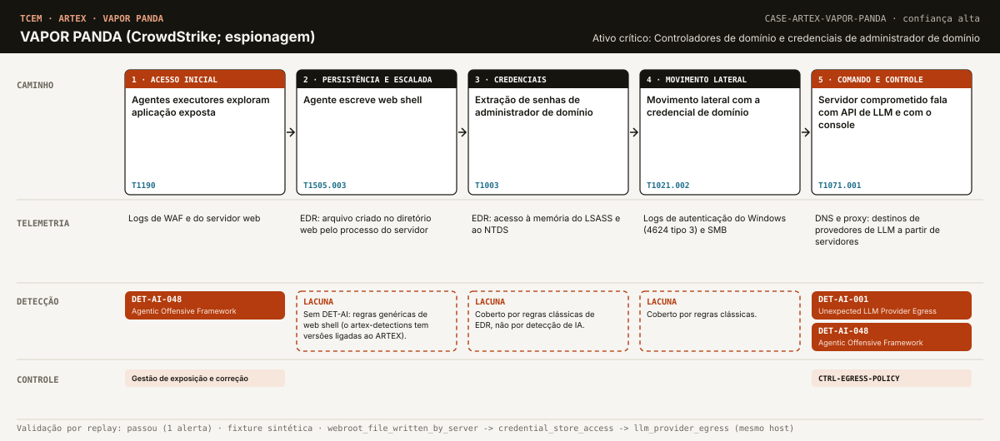
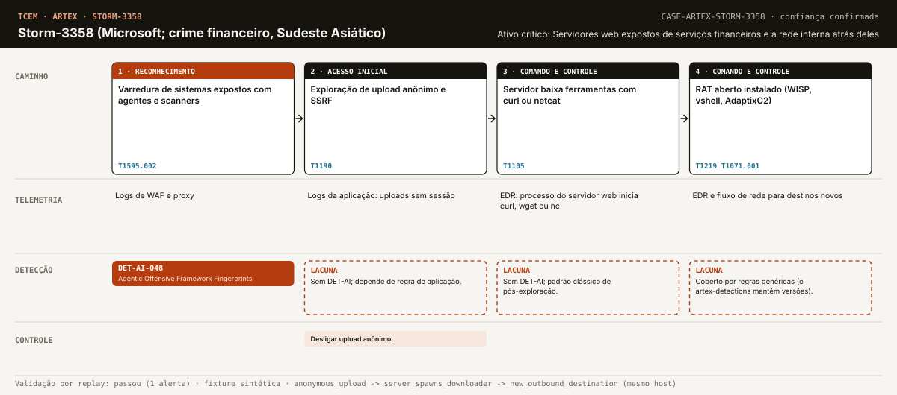
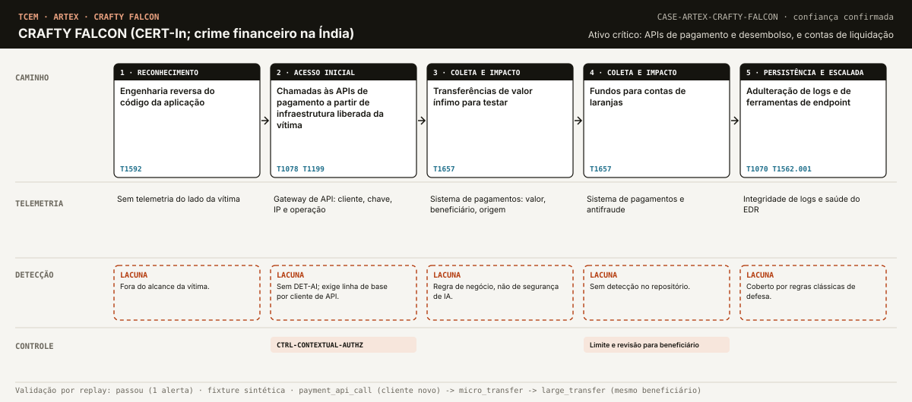
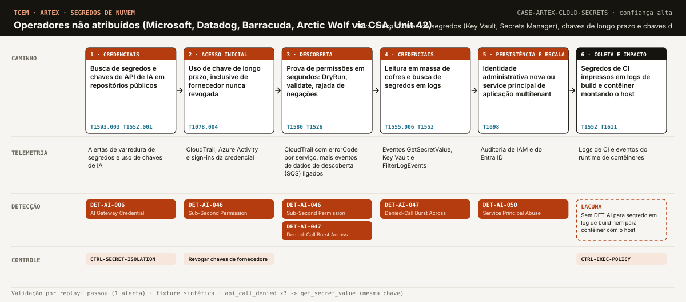
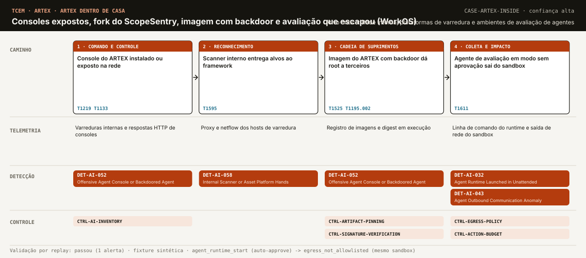

<p class="rpt-head"><span>LLMI-TM-ARTEX · v0.1</span><span class="tlp">TLP:CLEAR</span><span>Corte 2026-11-22</span></p>

<div class="injected" markdown="1">
Modelagem feita com o **TCEM, Threat Context Engineering Method** ([Cyber-Threat-Context-Modeling](https://github.com/Ridd1kulusC0d3r/Cyber-Threat-Context-Modeling), v0.5.1), método do mesmo autor deste repositório. Cada caso é um arquivo TCEM em `tcem/cases/` que carrega no próprio toolkit (`tce validate`) e é validado aqui por `scripts/tcem_validate.py`. Os fatos vêm dos registros e fontes citados; a modelagem (ativo crítico, ordem dos passos, prioridade) é julgamento do analista.
</div>

<div class="bluf" markdown="1">
Seis caminhos de ataque do ARTEX, com 30 passos ao todo. Em 17 deles há uma detecção do repositório; nos outros 13 a cobertura depende de regras clássicas ou de telemetria de negócio. O ARTEX deixa marca no ritmo (varredura, spray, prova de permissões, saída para APIs de LLM), e é ali que as detecções de IA funcionam. Depois do acesso, a intrusão volta a ser clássica, e o caso CRAFTY FALCON mostra que contra fraude a detecção que vale é a de negócio.
</div>

## 1. Como ler

Cada caso segue a cadeia do TCEM: **ativo crítico → contexto de ameaça → caminho do ator → contrato de telemetria → detecção → validação → decisão**. No diagrama, a linha de cima é o caminho na ordem das fontes; abaixo de cada passo ficam a telemetria que o torna visível, a detecção do repositório (laranja) ou a lacuna (tracejado), e os controles que reduzem o passo.

| Elemento | O que é |
|---|---|
| Caminho | Passos observados pelas fontes, em ordem, com técnicas ATT&CK |
| Telemetria | O que precisa ser coletado para ver o passo |
| Detecção | `DET-AI-0xx` do repositório, ou lacuna declarada |
| Validação | Replay de eventos sintéticos contra a lógica da detecção, com resultado esperado |
| Decisão | O que fazer, ligado ao ativo, à hipótese e à evidência |

## 2. Visão geral



| Caso | Quem | Confiança | Passos | Com DET-AI | Validação |
|---|---|---|---|---|---|
| Storm-0940 | Storm-0940 (Microsoft; nexo China, alinhado ao Estado) | alta | 6 | 5 | passou |
| VAPOR PANDA | VAPOR PANDA (CrowdStrike; espionagem) | alta | 5 | 2 | passou |
| Storm-3358 | Storm-3358 (Microsoft; crime financeiro, Sudeste Asiático) | confirmada | 4 | 1 | passou |
| CRAFTY FALCON | CRAFTY FALCON (CERT-In; crime financeiro na Índia) | confirmada | 5 | 0 | passou |
| Segredos de nuvem | Operadores não atribuídos (Microsoft, Datadog, Barracuda, Arctic Wolf via CSA, Unit 42) | alta | 6 | 5 | passou |
| ARTEX dentro de casa | Consoles expostos, fork do ScopeSentry, imagem com backdoor e avaliação que escapou (WorkOS) | alta | 4 | 4 | passou |

## 3. Storm-0940

**Quem:** Storm-0940 (Microsoft; nexo China, alinhado ao Estado). **Registros:** `ACTOR-STORM-0940`, `CAMPAIGN-STORM-0940-ARTEX-CONNECTWISE`, `CAMPAIGN-ARTEX-IT-SOFTWARE-VENDORS`.

**Ativo crítico:** Tenant Entra ID e aplicações OAuth com acesso a dados de clientes. Quem controla o tenant e as aplicações controla o acesso aos dados dos clientes atendidos por ele.

Ataque de identidade em cadência de máquina conduzido por ARTEX, seguido de abuso de OAuth e uso de um fornecedor de backup como ponte.



| # | Fase | Passo | ATT&CK | Detecção | Controle |
|---|---|---|---|---|---|
| 1 | Reconhecimento | Varredura contínua com impressões do ARTEX | T1595.002 | `DET-AI-048` | – |
| 2 | Credenciais | Password spraying em ritmo fixo: 327 contas de 8 organizações em 10 a 14/10 | T1110.003 | `DET-AI-049` | MFA resistente a phishing |
| 3 | Acesso inicial | Login válido logo depois do spray | T1078.004 | `DET-AI-049` | Acesso condicional |
| 4 | Persistência e escalada | Aplicação OAuth ganha credencial nova ou concede papel a si mesma | T1098.001 T1098.003 T1528 | `DET-AI-050` | Consentimento só por administrador |
| 5 | Coleta e impacto | Leitura em massa via Microsoft Graph acelerada por IA | T1087.004 T1530 | `DET-AI-050` | – |
| 6 | Cadeia de suprimentos | Fornecedor de backup (ConnectWise) usado como ponte para tenants de clientes | T1199 T1195 | lacuna: Nenhuma detecção do repositório cobre o uso da relação de confiança do provedor. | – |

**Hipótese.** Um operador com ARTEX consegue sair de uma senha fraca a uma aplicação OAuth com acesso a dados de clientes em poucas horas. Alternativas: erro de senha de usuários legítimos seguido de mudança administrativa planejada.

**Validação.** Spray em cadência de máquina que termina em sucesso e credencial nova de aplicação (`spray_rhythm_burst (DET-AI-049) -> signin_success -> app_credential_added (mesmo IP de origem)`). Uma rajada de spray em ritmo fixo de um IP que acerta e depois adiciona credencial a uma aplicação (1 alerta); um usuário que erra a senha e entra (sem alerta); um administrador que adiciona credencial sem falhas antes (sem alerta). Resultado do replay: 1 alerta, passou.

**Lacunas de inteligência.** (1) Quais identidades de fornecedores (backup, MSP) têm acesso aos nossos tenants e como seus logins aparecem? (2) A Microsoft atribui o caso ConnectWise ao Storm-0940; a sobreposição com a campanha descrita pela Wiz é avaliação da Wiz.

**Decisões propostas.** (1) Coletar sign-ins com horário ao segundo e alertar a sequência spray, sucesso e credencial nova de aplicação. (2) Inventariar e restringir identidades de provedores com acesso aos tenants.

Arquivo do caso: `tcem/cases/CASE-ARTEX-STORM-0940/case.json`.

## 4. VAPOR PANDA

**Quem:** VAPOR PANDA (CrowdStrike; espionagem). **Registros:** `ACTOR-VAPOR-PANDA`, `CAMPAIGN-VAPOR-PANDA-ARTEX`.

**Ativo crítico:** Controladores de domínio e credenciais de administrador de domínio. Com elas o operador alcança qualquer servidor da organização.

Agentes planejador e executores do ARTEX, sobretudo com DeepSeek, em 14 países em 11 dias; pós-exploração confirmada em 9 organizações.



| # | Fase | Passo | ATT&CK | Detecção | Controle |
|---|---|---|---|---|---|
| 1 | Acesso inicial | Agentes executores exploram aplicação exposta | T1190 | `DET-AI-048` | Gestão de exposição e correção |
| 2 | Persistência e escalada | Agente escreve web shell | T1505.003 | lacuna: Sem DET-AI: regras genéricas de web shell (o artex-detections tem versões ligadas ao ARTEX). | – |
| 3 | Credenciais | Extração de senhas de administrador de domínio | T1003 | lacuna: Coberto por regras clássicas de EDR, não por detecção de IA. | – |
| 4 | Movimento lateral | Movimento lateral com a credencial de domínio | T1021.002 | lacuna: Coberto por regras clássicas. | – |
| 5 | Comando e controle | Servidor comprometido fala com API de LLM e com o console | T1071.001 | `DET-AI-001`, `DET-AI-048` | CTRL-EGRESS-POLICY |

**Hipótese.** A parte específica de IA desta campanha aparece no reconhecimento e na saída para APIs de LLM; o resto é pós-exploração clássica. Alternativas: ferramenta legítima de ia instalada no servidor.

**Validação.** Web shell seguido de acesso a credenciais e de saída para API de LLM no mesmo servidor (`webroot_file_written_by_server -> credential_store_access -> llm_provider_egress (mesmo host)`). Um servidor web com arquivo novo, acesso a credenciais e saída para API de LLM (1 alerta); um cache gravado pelo servidor (sem alerta); um desenvolvedor usando API de LLM (sem alerta). Resultado do replay: 1 alerta, passou.

**Lacunas de inteligência.** (1) Quais servidores podem falar com APIs de LLM e quais não deveriam? (2) A CrowdStrike não publica os indicadores do console usado.

**Decisões propostas.** (1) Bloquear saída de servidores para provedores de LLM fora de uma lista aprovada. (2) Tratar web shell em servidor exposto como incidente de domínio até prova em contrário.

Arquivo do caso: `tcem/cases/CASE-ARTEX-VAPOR-PANDA/case.json`.

## 5. Storm-3358

**Quem:** Storm-3358 (Microsoft; crime financeiro, Sudeste Asiático). **Registros:** `ACTOR-STORM-3358`, `CAMPAIGN-STORM-3358-ARTEX-FINANCE`.

**Ativo crítico:** Servidores web expostos de serviços financeiros e a rede interna atrás deles. São a porta de entrada que o ator procura em escala.

ARTEX somado a ferramentas automáticas: varredura, upload anônimo e SSRF, e RATs abertos (WISP, vshell, AdaptixC2) baixados com netcat e curl.



| # | Fase | Passo | ATT&CK | Detecção | Controle |
|---|---|---|---|---|---|
| 1 | Reconhecimento | Varredura de sistemas expostos com agentes e scanners | T1595.002 | `DET-AI-048` | – |
| 2 | Acesso inicial | Exploração de upload anônimo e SSRF | T1190 | lacuna: Sem DET-AI; depende de regra de aplicação. | Desligar upload anônimo |
| 3 | Comando e controle | Servidor baixa ferramentas com curl ou netcat | T1105 | lacuna: Sem DET-AI; padrão clássico de pós-exploração. | – |
| 4 | Comando e controle | RAT aberto instalado (WISP, vshell, AdaptixC2) | T1219 T1071.001 | lacuna: Coberto por regras genéricas (o artex-detections mantém versões). | – |

**Hipótese.** O valor do agente para este ator é a escala da varredura; a intrusão em si segue o padrão clássico de servidor web. Alternativas: automação legítima que baixa atualizações.

**Validação.** Upload anônimo seguido de download por processo do servidor e conexão nova de saída (`anonymous_upload -> server_spawns_downloader -> new_outbound_destination (mesmo host)`). Upload anônimo, curl iniciado pelo servidor e destino novo no mesmo host (1 alerta); upload seguido de destino novo sem downloader (sem alerta). Resultado do replay: 1 alerta, passou.

**Lacunas de inteligência.** (1) A Microsoft não diz em que etapas exatamente o ARTEX substituiu as ferramentas convencionais.

**Decisões propostas.** (1) Contrato de telemetria: processo do servidor web iniciando downloaders é coletado e alertado. (2) Desligar upload anônimo onde não houver necessidade de negócio.

Arquivo do caso: `tcem/cases/CASE-ARTEX-STORM-3358/case.json`.

## 6. CRAFTY FALCON

**Quem:** CRAFTY FALCON (CERT-In; crime financeiro na Índia). **Registros:** `CAMPAIGN-CRAFTY-FALCON-BFSI-INDIA`.

**Ativo crítico:** APIs de pagamento e desembolso, e contas de liquidação. O ator chama as APIs de dentro da infraestrutura liberada da própria vítima.

ARTEX, PentAGI, Cairn e CyberStrikeAI contra NBFCs, fintechs, agregadores de pagamento e plataformas cripto; o ator volta a atacar quem já corrigiu.



| # | Fase | Passo | ATT&CK | Detecção | Controle |
|---|---|---|---|---|---|
| 1 | Reconhecimento | Engenharia reversa do código da aplicação | T1592 | lacuna: Fora do alcance da vítima. | – |
| 2 | Acesso inicial | Chamadas às APIs de pagamento a partir de infraestrutura liberada da vítima | T1078 T1199 | lacuna: Sem DET-AI; exige linha de base por cliente de API. | CTRL-CONTEXTUAL-AUTHZ |
| 3 | Coleta e impacto | Transferências de valor ínfimo para testar | T1657 | lacuna: Regra de negócio, não de segurança de IA. | – |
| 4 | Coleta e impacto | Fundos para contas de laranjas | T1657 | lacuna:  | Limite e revisão para beneficiário novo |
| 5 | Persistência e escalada | Adulteração de logs e de ferramentas de endpoint | T1070 T1562.001 | lacuna: Coberto por regras clássicas de defesa. | – |

**Hipótese.** Contra este ator, a detecção que funciona é de negócio: o comportamento do cliente de API e do beneficiário, não a impressão da ferramenta. Alternativas: validação de conta legítima com centavos antes de um pagamento real.

**Validação.** Cliente de API novo faz transferência ínfima e, em seguida, valor alto ao mesmo beneficiário (`payment_api_call (cliente novo) -> micro_transfer -> large_transfer (mesmo beneficiário)`). Cliente de API novo, transferência de teste e valor alto ao mesmo beneficiário (1 alerta); o mesmo padrão de um cliente conhecido, como validação de conta legítima (sem alerta). Resultado do replay: 1 alerta, passou.

**Lacunas de inteligência.** (1) O CERT-In não publica quantas entidades foram afetadas nem valores. (2) Não há fonte de grau A além do aviso do CERT-In.

**Decisões propostas.** (1) Linha de base por cliente de API de pagamento, com alerta para cliente novo. (2) Revisão humana para beneficiário novo acima de um limite.

Arquivo do caso: `tcem/cases/CASE-ARTEX-CRAFTY-FALCON/case.json`.

## 7. Segredos de nuvem

**Quem:** Operadores não atribuídos (Microsoft, Datadog, Barracuda, Arctic Wolf via CSA, Unit 42). **Registros:** `CAMPAIGN-ARTEX-EXPOSED-SECRETS`, `CAMPAIGN-ARTEX-AWS`, `INCIDENT-BARRACUDA-ARTEX-CLOUD-2026-11`, `CAMPAIGN-ANTIFOX-AWS-IIS`, `CAMPAIGN-ARTEX-IDENTITY-WORKFLOWS`.

**Ativo crítico:** Cofres de segredos (Key Vault, Secrets Manager), chaves de longo prazo e chaves de API de IA. Cada segredo encontrado abre a próxima conta: a Barracuda viu cerca de 10 contas em 44 horas.

O padrão mais documentado do ARTEX: o agente procura segredos, prova o que cada chave pode fazer em segundos e encadeia o próximo acesso.



| # | Fase | Passo | ATT&CK | Detecção | Controle |
|---|---|---|---|---|---|
| 1 | Credenciais | Busca de segredos e chaves de API de IA em repositórios públicos | T1593.003 T1552.001 | `DET-AI-006` | CTRL-SECRET-ISOLATION |
| 2 | Acesso inicial | Uso de chave de longo prazo, inclusive de fornecedor nunca revogada | T1078.004 | `DET-AI-046` | Revogar chaves de fornecedores |
| 3 | Descoberta | Prova de permissões em segundos: DryRun, validate, rajada de negações | T1580 T1526 | `DET-AI-046`, `DET-AI-047` | – |
| 4 | Credenciais | Leitura em massa de cofres e busca de segredos em logs | T1555.006 T1552 | `DET-AI-047` | – |
| 5 | Persistência e escalada | Identidade administrativa nova ou service principal de aplicação multitenant | T1098 | `DET-AI-050` | – |
| 6 | Coleta e impacto | Segredos de CI impressos em logs de build e contêiner montando o host | T1552 T1611 | lacuna: Sem DET-AI para segredo em log de build nem para contêiner com o host montado. | CTRL-EXEC-POLICY |

**Hipótese.** Contra o ARTEX, o sinal mais confiável é o ritmo: muitas negações em segundos com a mesma chave, seguidas de sucesso. Alternativas: ferramenta de inventário que testa permissões; pipeline de deploy recém-configurado.

**Validação.** Rajada de chamadas negadas seguida de leitura de segredo com a mesma chave (`api_call_denied x3 -> get_secret_value (mesma chave)`). Três negações em serviços diferentes e uma leitura de segredo com a mesma chave (1 alerta); uma negação isolada antes de leitura legítima (sem alerta). Resultado do replay: 1 alerta, passou.

**Lacunas de inteligência.** (1) Quais chaves de longo prazo e de fornecedores existem e quando foram usadas pela última vez? (2) A leitura do AntiFox é da CSA sobre o original da Arctic Wolf, não lido.

**Decisões propostas.** (1) Revogar chaves de longo prazo sem uso e todas as entregues a fornecedores encerrados. (2) Alertar a sequência negações, sucesso e leitura de segredo por chave.

Arquivo do caso: `tcem/cases/CASE-ARTEX-CLOUD-SECRETS/case.json`.

## 8. ARTEX dentro de casa

**Quem:** Consoles expostos, fork do ScopeSentry, imagem com backdoor e avaliação que escapou (WorkOS). **Registros:** `TOOL-ARTEX`, `TOOL-SCOPESENTRY`, `INCIDENT-WORKOS-ARTEX-SANDBOX-ESCAPE`.

**Ativo crítico:** Rede interna, plataformas de varredura e ambientes de avaliação de agentes. Um console ou um agente de avaliação dentro da rede tem o alcance da rede.

Não é um ator: são os jeitos de o ARTEX aparecer dentro da organização, por instalação não autorizada, por integração com scanner, por imagem adulterada ou por um teste que escapa.



| # | Fase | Passo | ATT&CK | Detecção | Controle |
|---|---|---|---|---|---|
| 1 | Comando e controle | Console do ARTEX instalado ou exposto na rede | T1219 T1133 | `DET-AI-052` | CTRL-AI-INVENTORY |
| 2 | Reconhecimento | Scanner interno entrega alvos ao framework | T1595 | `DET-AI-058` | – |
| 3 | Cadeia de suprimentos | Imagem do ARTEX com backdoor dá root a terceiros | T1525 T1195.002 | `DET-AI-052` | CTRL-ARTIFACT-PINNING, CTRL-SIGNATURE-VERIFICATION |
| 4 | Coleta e impacto | Agente de avaliação em modo sem aprovação sai do sandbox | T1611 | `DET-AI-032`, `DET-AI-043` | CTRL-EGRESS-POLICY, CTRL-ACTION-BUDGET |

**Hipótese.** O risco imediato do ARTEX para quem defende inclui o próprio ARTEX: consoles expostos, forks e testes sem contenção. Alternativas: red team autorizado.

**Validação.** Agente iniciado sem aprovação humana alcança destino fora da lista do sandbox (`agent_runtime_start (auto-approve) -> egress_not_allowlisted (mesmo sandbox)`). Agente sem aprovação que alcança destino fora da lista (1 alerta); agente com aprovação humana e destino fora da lista (vai para a fila de egress, não para este alerta). Resultado do replay: 1 alerta, passou.

**Lacunas de inteligência.** (1) Quem na organização roda frameworks ofensivos agênticos e onde? (2) A contagem de consoles expostos é da Censys e da Spectrum; console exposto não é atacante.

**Decisões propostas.** (1) Inventário e autorização explícita para frameworks ofensivos agênticos. (2) Sandboxes de avaliação sem saída de rede fora de lista fechada.

Arquivo do caso: `tcem/cases/CASE-ARTEX-INSIDE/case.json`.

## 9. O que não foi modelado

| Relato | Registro | Por quê |
|---|---|---|
| Pearl Sleet e Onyx Sleet | `CAMPAIGN-PEARL-SLEET-ARTEX` | A Microsoft confirma o uso de ARTEX, mas não descreve para que ele foi usado em uma intrusão. |
| TAG-217 e o operador multimodelo | `INCIDENT-TAG-217-SOUTH-KOREA-FINANCE` | A Recorded Future avisa que a evidência não mostra quanto a IA acelerou os ataques; a Zscaler não nomeia o ator. |
| Comissão Europeia | `INCIDENT-EC-ARTEX-2026-11` | Relato de imprensa sem ator, falha nem papel do ARTEX (invasão ou só varredura). |
| Eye Security | `INCIDENT-EYE-ARTEX-IR` | Vítima e caminho não publicados; o relato confirma escala e velocidade, não os passos. |
| Grupos de extorsão e clusters PRC (GTIG) | `CAMPAIGN-ARTEX-EXTORTION-AND-PRC-CLUSTERS` | Sem passos por intrusão; a parte de credenciais está no caso de segredos de nuvem. |

## 10. Como reproduzir

```bash
python3 scripts/build_tcem.py        # gera casos, fixtures, diagramas e este relatório
python3 scripts/tcem_validate.py     # checa estrutura, referências e replay
tce validate tcem/cases/CASE-ARTEX-STORM-0940   # no toolkit TCEM
```

## 11. Fontes

| ID | Publicador | Grau | Data |
|---|---|---|---|
| [`SRC-BARRACUDA-ARTEX-2026-11`](https://blog.barracuda.com/2026/11/11/anatomy-of-a-machine-speed-intrusion) | Barracuda Networks | A | 2026-11-11 |
| [`SRC-CENSYS-ARTEX-2026-11`](https://censys.com/blog/artex-agentic-asbestos) | Censys | A | 2026-11-05 |
| [`SRC-CERTIN-CIAD-2026-0058`](https://www.cert-in.org.in/s2cMainServlet?pageid=PUBVLNOTES02&VLCODE=CIAD-2026-0058) | CERT-In | A | 2026-11-04 |
| [`SRC-CROWDSTRIKE-VAPOR-PANDA-2026-10`](https://www.crowdstrike.com/en-us/blog/vapor-panda-uses-artex-to-scale-global-campaign/) | CrowdStrike Counter Adversary Operations | A | 2026-10-29 |
| [`SRC-DATADOG-ARTEX-AWS`](https://securitylabs.datadoghq.com/articles/artex-agentic-attacks-aws-environments/) | Datadog Security Labs | A | – |
| [`SRC-FBI-FLASH-20261113-ARTEX`](https://www.ic3.gov/CSA/2026/261113.pdf) | FBI | A | 2026-11-13 |
| [`SRC-GH-SCOPESENTRY-NIUDAII`](https://github.com/niudaii/ScopeSentry) | GitHub (niudaii; upstream Autumn-27/ScopeSentry) | B | 2026-08-26 |
| [`SRC-MSFT-ARTEX-SECRETS-2026-11`](https://www.microsoft.com/en-us/security/blog/2026/11/05/threat-actors-use-agentic-ai-tooling-to-find-and-abuse-exposed-secrets/) | Microsoft Threat Intelligence | A | 2026-11-05 |
| [`SRC-MSFT-STORM-0940-ARTEX`](https://www.microsoft.com/en-us/security/blog/2026/10/21/storm-0940-uses-artex-agentic-ai-connectwise-supply-chain-compromise/) | Microsoft Threat Intelligence | A | 2026-10-21 |
| [`SRC-MSFT-STORM-3358-ARTEX`](https://www.microsoft.com/en-us/security/blog/2026/11/06/artex-abuse-expands-as-cybercriminals-target-financial-sector/) | Microsoft Threat Intelligence | A | 2026-11-06 |
| [`SRC-SPECTRUM-SWARM-CHASING`](https://www.spectrum.security/blog/offensive-ai-tools-in-the-wild) | Spectrum (Delta research) | B | 2026-11-18 |
| [`SRC-UNIT42-ARTEX-2026-11`](https://unit42.paloaltonetworks.com/artex-and-ai-powered-red-teaming-tools/) | Palo Alto Networks Unit 42 | A | 2026-11-11 |
| [`SRC-WIZ-ARTEX-VENDORS`](https://www.wiz.io/blog/artex-in-the-wild-storm-0940-expands-targeting-of-it-and-software-vendors) | Wiz Research | A | 2026-10-22 |
| [`SRC-WORKOS-BULLETIN-2026-10-30`](https://workos.com/security/bulletins/update-for-october-30th-2026-data-security-incident) | WorkOS | A | – |

Método: TCEM, Threat Context Engineering Method, v0.5.1 ([repositório](https://github.com/Ridd1kulusC0d3r/Cyber-Threat-Context-Modeling)). Mesmo autor deste repositório: a referência descreve o método usado, não é validação independente.
