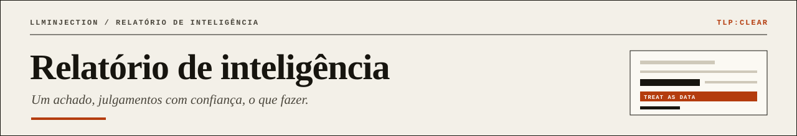

LLMI-AL-AAAAMMDD-NNTLP:CLEARPublicado AAAA-MM-DD HH:MM BRT

Para o que não pode esperar a edição semanal: entrada nova no KEV de software de IA, exploração em massa, pacote malicioso em circulação. Uma página, publicada no mesmo dia. Vira item da edição semanal seguinte.

O que aconteceu, quem precisa agir e o que fazer nas próximas 24 horas.

## 1. O que aconteceu

| Campo | Valor |
|---|---|
| Produto e versões afetadas | … |
| Identificador | CVE, GHSA ou nome do caso |
| Estado | exploração confirmada / PoC público / divulgado |
| Evidência | KEV (data), aviso do fornecedor, relato de terceiros com grau |

## 2. Você está exposto?
Como conferir versão e exposição, em comandos de leitura.

## 3. Faça agora
1. Corrigir ou isolar: versão mínima e alternativa se não der para atualizar.
2. Rotacionar: quais credenciais o produto guarda.
3. Procurar: a hipótese de hunting e a janela.

## 4. Detecção

| Detecção (`DET-AI-…`) | Onde procurar | O que confirma |
|---|---|---|

## 5. Indicadores

| Tipo | Valor (desarmado) | Tier | Válido até | Fonte |
|---|---|---|---|---|

## 6. Brasil e América Latina
Evidência regional, ou a frase padrão de ausência.

## 7. Fontes e retroalimentação

| ID | Publicador | Grau | Data |
|---|---|---|---|

Registros criados: `VULN-…`, `INCIDENT-…`. Entra na edição semanal AAAA-Www.
