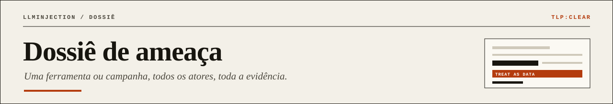

LLMI-DS-slug · v0.1TLP:CLEARCorte AAAA-MM-DD

**Notas de versão.** Uma linha por versão: fontes lidas no original, registros criados no grafo e o que ainda falta ler. Para gerar o PDF: declare `pdf: reports/pdf/LLMI-DS-SLUG.pdf` no cabeçalho e rode `make print`.

O que é, quem usa, o que mudou para o defensor, o que fazer primeiro.

## 1. Julgamentos-chave

| # | Julgamento | Probabilidade | Confiança | Base |
|---|---|---|---|---|

## 2. O que é (visão do defensor)
- **Arquitetura relatada:**
- **Origem e autoria:** (autoria de ferramenta não é autoria de ataque)
- **Modelos que usa:**
- **Superfície exposta do próprio framework:**

Fora do escopo: instruções de uso ou implantação.

## 3. Linha do tempo

| Data | Evento | Fonte | Confiança |
|---|---|---|---|

## 4. Quem usa

| Ator | Nexo | Uso relatado | Papel da IA | Fonte |
|---|---|---|---|---|

Usar a mesma ferramenta não liga atores entre si.

## 5. Vítimas e setores

| Setor | Região | Caso | Impacto relatado | Fonte |
|---|---|---|---|---|

## 6. Cadeia de ataque observada

| Fase | Técnica (LLMI-T / ATLAS / ATT&CK) | Evidência |
|---|---|---|

## 7. O que a IA mudou de fato
Tempo, cadência, paralelismo e o limite que as próprias fontes declaram.

### Censo de exposição
Contagens de terceiros, com data, método e a ressalva de que console exposto não é atacante.

### Ecossistema
Forks, variantes, integrações e ferramentas derivadas (`derived-from`, `integrates-with`).

## 8. Detecção

| Detecção (`DET-AI-…`) | O que pega | Regra pronta | Regras de terceiros (licença) |
|---|---|---|---|

Sinais de comportamento que não dependem de IOC primeiro.

## 9. Threat hunting

| Hipótese | Janela | Onde procurar | O que confirma |
|---|---|---|---|

## 10. Mitigação priorizada

| Controle | Camada | Esforço | Efeito |
|---|---|---|---|

## 11. Indicadores
Com tier, proveniência e validade. Se não forem reproduzidos, diga onde estão.

## 12. Camada 8: fator humano
O que sai das mãos do operador, o que fica, e o viés a vigiar do lado do defensor.

## 13. O que este dossiê não afirma
Hipóteses concorrentes, atribuições que as fontes não fazem e confusões comuns.

## 14. Brasil e América Latina
Evidência regional, ou: *impacto regional não demonstrado nas fontes consultadas*. Hipótese a testar, se houver.

## 15. Para acompanhar
O que confirmaria e o que derrubaria os julgamentos; data da próxima revisão.

## 16. Mudanças no repositório
Registros criados ou alterados e o que ficou na fila de pesquisa.

## 17. Fontes

| ID | Publicador | Grau | Lido no original | Data |
|---|---|---|---|---|

**Ainda a ler:** …
