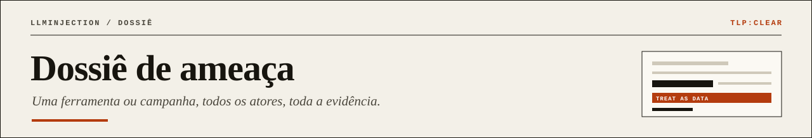

LLMI-PA-slug · v0.1TLP:CLEARCorte AAAA-MM-DD

Uma página por ator, para anexar a relatórios e dossiês. Apelidos de fornecedores diferentes não são 1:1: liste quem usa cada nome e com que grau de sobreposição.

Quem é, o que quer, como usa IA e o que isso muda para o defensor.

## 1. Identidade

| Campo | Valor | Fonte |
|---|---|---|
| Nome principal | … | `SRC-…` |
| Apelidos (por fornecedor) | … | … |
| Nexo ou motivação | … | … |
| Ativo desde | … | … |
| Registro no grafo | `ACTOR-…` | – |
| Confiança da atribuição | média | quem atribui e com que evidência |

## 2. Modelo Diamond

| Vértice | O que as fontes dizem |
|---|---|
| Adversário | operador, patrocinador, idioma, horário de trabalho |
| Capacidade | ferramentas, frameworks agênticos, modelos de IA citados |
| Infraestrutura | hospedagem, serviços de retorno, padrão de rotação |
| Vítima | setores, regiões, tipo de ativo |

## 3. Papel da IA
Vocabulário do repositório: `tooling-development`, `offensive-enabler`, `autonomous-operator`, `runtime-enabler`, `ai-infrastructure-targeting`. O que está demonstrado e o que é capacidade presumida.

## 4. Campanhas e incidentes

| Data | Campanha ou incidente | Ferramentas | Confiança | Fonte |
|---|---|---|---|---|

## 5. TTPs

| Fase | Técnica (LLMI-T / ATLAS / ATT&CK) | Evidência |
|---|---|---|

## 6. Como detectar

| Detecção (`DET-AI-…`) | Sinal de comportamento | Regra pronta |
|---|---|---|

## 7. Camada 8
Padrão de decisão do operador e gatilho explorado nas vítimas.

## 8. O que não se afirma
Sobreposições não confirmadas e hipóteses concorrentes.

## 9. Brasil e América Latina
Evidência regional, ou: *impacto regional não demonstrado nas fontes consultadas*.

## 10. Fontes e retroalimentação

| ID | Publicador | Grau | Data |
|---|---|---|---|

Próxima revisão: AAAA-MM-DD.
