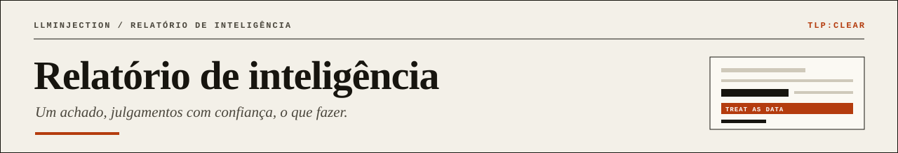

LLMI-RI-AAAA-NNN · v1.0TLP:CLEARCorte AAAA-MM-DD

Modelo completo. Siga a ordem de `ESTRUTURA.md`. As chaves do cabeçalho ligam os blocos gerados: `kpis` (faixa de números), `kev_chart` (gráfico do KEV), `hot_days` (O mais quente agora) e `appendix` (apêndices A e B). Na edição impressa, capa, ficha, sumário, mapa de atores, matriz de detecção, glossário e contracapa são montados por `make print`.

**Notas de versão e verificação.** Uma linha por versão: o que entrou, o que foi conferido em fonte primária (KEV, NVD, aviso do fornecedor) e o que ficou de fora e por quê.

Até cinco linhas: o que aconteceu, quem é afetado, o que muda para o defensor e o que fazer primeiro.

## 1. Sumário executivo

Os achados que orientam o restante do relatório (de cinco a sete):

1. **Achado em uma frase.** Evidência e número, com fonte.
2. **…**

**Prioridades imediatas:** três a cinco ações, com versão mínima ou controle nomeado.

### Resumo para diretoria

| Pergunta | Resposta em uma linha |
|---|---|
| Qual é o risco para o negócio? | … |
| Estamos expostos? Como saber? | … |
| O que decidir nesta semana? | … |
| Quanto custa não agir? | … |

### Julgamentos-chave

| # | Julgamento | Probabilidade | Confiança | Base |
|---|---|---|---|---|
| J1 | … | provável | alta | `SRC-…` |
| J2 | … | possível | média | `SRC-…` |

## 2. Escopo, metodologia e confiança

**O que entra** e **o que fica de fora**. Janela de coleta e data de corte.

| Nível | Critério | Exemplos neste relatório |
|---|---|---|
| A — confirmado | Fonte primária ou três veículos independentes | … |
| B — provável | Pesquisa de um fornecedor, reproduzida pela imprensa | … |
| C — a validar | Fonte única, agregador ou alegação do próprio fornecedor | … |

### Perguntas de inteligência (PIR)

| PIR | Pergunta | Situação |
|---|---|---|
| PIR-1 | … | respondida / parcial / em aberto |

### Fato, inferência, lacuna

| Relato da fonte | Inferência do analista | Lacuna |
|---|---|---|

## 3. Panorama de ameaças

| Camada | O que guarda | Classe de falha dominante | Estado no período |
|---|---|---|---|

Tendências que atravessam as camadas: volume, velocidade, lacuna de correção, governança.

## 4. Vulnerabilidades

| CVE | Produto | Falha | CVSS | Afetadas → correção | Exploração | Conf. |
|---|---|---|---|---|---|---|

### Vulnerabilidades encontradas por IA
Números de terceiros, casos com exploração e a tabela de marcos (alegação da fonte ao lado da checagem).

### Por produto
Um bloco por produto: o padrão de falha, o que corrigir e o que tratar como comprometido.

## 5. Cronologia de incidentes

Categorias: EXP (exploração), SC (cadeia de suprimentos), PI (injeção de prompt), OFF (IA usada por atacante), AUT (agente sem adversário), ID (identidade e credenciais), EXPO (exposição ou configuração).

| Data (AAAA) | Incidente | Cat. | O que aconteceu |
|---|---|---|---|

## 6. Atores, campanhas e TTPs

| Ator ou conjunto | Motivação | Alvo em IA | Marca operacional |
|---|---|---|---|

### Mapeamento de técnicas

| Técnica observada | ATLAS | ATT&CK | OWASP (LLM e Agentic) | Casos |
|---|---|---|---|---|

### Mapeamento de modelos de IA
Famílias de modelo citadas nos casos, com a ressalva de que citação não é atribuição.

## 7. Modelagem de ameaças

### Ativos

| Ativo | Por que o atacante quer | Onde fica |
|---|---|---|

### Fronteiras de confiança

| # | Fronteira | O que cruza | Controle esperado |
|---|---|---|---|

### Cenários de abuso prioritários
Numerados, cada um com as fronteiras envolvidas e um caso de referência.

### Matriz de risco

| Camada | Probabilidade | Impacto | Risco | Motivo |
|---|---|---|---|---|
| … | alta / média / baixa | alto / médio / baixo | … | … |

## 8. Threat detection

### Telemetria necessária

| Fonte | O que coletar | Cobre |
|---|---|---|

### Regras por produto

| Alvo | Lógica de detecção | Severidade | Falso positivo esperado |
|---|---|---|---|

### Matriz de detecção
Gerada dos dados: técnica × evidências × detecções × regras prontas × testes × guardrail × hardening × monitoramento.

### Exemplos em formato Sigma
Regras com `status: experimental`, campos genéricos e falsos positivos declarados.

## 9. Threat hunting

| # | Hipótese | Janela | Onde procurar | O que confirma |
|---|---|---|---|---|

### Consultas de partida
Consultas de leitura, só para o ambiente do próprio defensor.

### Como tratar um achado
Ordem de rotação de credenciais e de contenção.

## 10. Hardening

### Versões mínimas

| Produto | Versão mínima | Motivo |
|---|---|---|

### Controles por camada

| Camada | Controle | Efeito |
|---|---|---|

## 11. Harness e guardrails

Camadas do harness, padrões de projeto, como testar os guardrails e critérios mínimos antes de produção.

## 12. Recomendações por público

| Público | Faça agora | Faça em 30 dias | Pergunte ao fornecedor |
|---|---|---|---|
| CISO e diretoria | … | … | … |
| SOC e detecção | … | … | … |
| Desenvolvimento e plataforma | … | … | … |
| Compras e fornecedores | … | … | … |

## 13. Plano de ação priorizado

### Matriz de priorização de patch
### Primeiros 30 dias: conter
### Dias 31 a 60: estruturar
### Dias 61 a 90: sustentar
### Indicadores para acompanhar

## 14. Camada 8: fator humano

| Lado | Pergunta | Resposta |
|---|---|---|
| Operador | Que decisão a IA tirou das mãos dele? | … |
| Vítima | Que gatilho foi explorado (autoridade, urgência, confiança na ferramenta)? | … |
| Analista | Que viés vigiar (ancoragem no primeiro relatório, viés de novidade)? | … |

## 15. Brasil e América Latina
Evidência regional, ou: *impacto regional não demonstrado nas fontes consultadas*.

## 16. Hipóteses concorrentes e previsões

| Hipótese | A favor | Contra | Situação |
|---|---|---|---|

| Previsão | Probabilidade | Como verificar | Resultado |
|---|---|---|---|

## 17. Indicadores

| Tipo | Valor (desarmado) | Tier | Válido até | Fonte |
|---|---|---|---|---|

## 18. Fontes e referências

### Qualidade das fontes

| Grau | Quantas | Lidas no original | Por resumo de busca |
|---|---|---|---|

### Lista

| ID | Publicador | Título | Grau | Data |
|---|---|---|---|---|

## 19. Retroalimentação
- Registros criados ou alterados: `ACTOR-…`, `CAMPAIGN-…`, `VULN-…`, `DET-AI-…`, `SRC-…`
- Itens de digest que originaram: `[LLMI-AAAAMMDD-NN]`
- Próxima revisão: AAAA-MM-DD · gatilhos de revisão: …

---

## Versão curta (LinkedIn, até 1.300 caracteres)

Gancho em uma linha (um número ou um contraste) · três bullets de evidência · uma linha "o que fazer" · link para a página · três hashtags.

