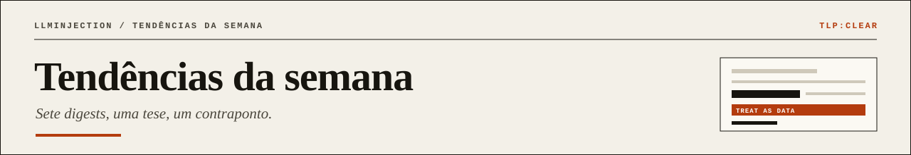

LLMI-TS-AAAA-WwwTLP:CLEARDigests de AAAA-MM-DD a AAAA-MM-DD

Origem: os sete digests diários da semana, o radar de fraude BR/LATAM e o Threat Intel de sábado. Só entra o que apareceu em dois ou mais dias, ou um item lido no original.

**A tendência em uma frase**, verbo no presente, sem adjetivo.

## Sinais

| # | Data | Sinal | Fonte | Item | Selo |
|---|---|---|---|---|---|
| 1 | … | … | … | `[LLMI-AAAAMMDD-NN]` | lido no original / secundária |
| 2 | … | … | … | … | … |
| 3 | … | … | … | … | … |

## O contraponto
O dado que enfraquece a tese.

## Segunda-feira do defensor
- Uma detecção:
- Um controle:

## Camada 8
O comportamento humano por trás, do atacante ou do defensor.

## Para acompanhar
O que confirmaria e o que derrubaria a tendência.

## Contador de tendências

| Tendência | Desde | Semanas ativa | Itens | Estado |
|---|---|---|---|---|
| … | AAAA-Www | n | n | emergente / consolidada / esfriando |

---

## Versão curta (LinkedIn, até 1.300 caracteres)

Gancho em uma linha (um número ou um contraste) · três bullets de evidência · uma linha "o que fazer" · link para esta página · três hashtags.

## Carrossel (cinco quadros)
Gancho · Evidência 1 · Evidência 2 · O que fazer · Fonte e link. Use o masthead desta edição como capa.
