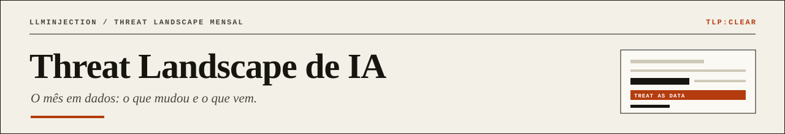

LLMI-TL-AAAA-MMTLP:CLEARSnapshot data/snapshots/AAAA-MM.json · Corte AAAA-MM-DD

Todo número desta página sai de `scripts/build_snapshot.py`, `scripts/diff_intelligence.py` ou `scripts/readme_stats.py`. Número digitado à mão não entra.

Três a cinco julgamentos do mês, cada um com selo de confiança e IDs.

## 1. Placar

| Atores | Campanhas | Incidentes | Técnicas | Vulnerabilidades | Fontes |
|---|---|---|---|---|---|
| n (Δ) | n (Δ) | n (Δ) | n (Δ) | n (Δ) | n (Δ) |

## 2. O que mudou

| Tipo | Novos | Alterados | Rebaixados ou removidos | Destaque |
|---|---|---|---|---|

Fonte: `reports/AAAA-MM-diff.md`.

## 3. Uso adversário de IA

### 3.1 Por nexo

| Nexo | Atores | Papel da IA | Confiança |
|---|---|---|---|

### 3.2 Por papel da IA (três meses)
`tooling-development` → `offensive-enabler` → `autonomous-operator`: quantos registros em cada degrau, mês a mês.

### 3.3 Frameworks ofensivos agênticos
ARTEX, PentAGI e outros: quem usa, para quê, o que está comprovado. Link para o dossiê de cada um.

## 4. Ataques contra sistemas de IA

| Técnica | Sinal no mês | Maturidade |
|---|---|---|
| LLMI-T001 … T028 | sinal novo / sem sinal público novo | observed-in-the-wild / disclosed-vulnerability / research-demonstrated |

## 5. Vulnerabilidades e supply chain de IA

| CVE | Produto | KEV | EPSS | Explorada em campo (fonte) | Correção |
|---|---|---|---|---|---|

Blocos fixos: gateways de IA, servidores e clientes MCP, runtimes locais, frameworks de agente, modelos e pacotes.

## 6. Cobertura defensiva
Matriz técnica × detecção × teste (`scripts/coverage_model.py`): projetado, rascunho, testado. A maior lacuna do mês e o que a fecha.

## 7. Setores e regiões
Brasil e América Latina em seção própria, com a regra de evidência regional.

## 8. Padrões e regulação
OWASP, MITRE ATLAS, NIST, CISA, EU AI Act, ANPD, PL 2338.

## 9. Previsões verificáveis

| Previsão para o próximo mês | Probabilidade | Como verificar | Resultado (mês seguinte) |
|---|---|---|---|

No mês seguinte, preencha a última coluna das previsões anteriores. O placar de acertos é o que dá credibilidade à série.

## 10. Fila de pesquisa

| Candidato | Por que importa | Dono | Prazo |
|---|---|---|---|

## 11. Método, limites e fontes
O que foi lido no original, o que veio de busca, o que falhou.
