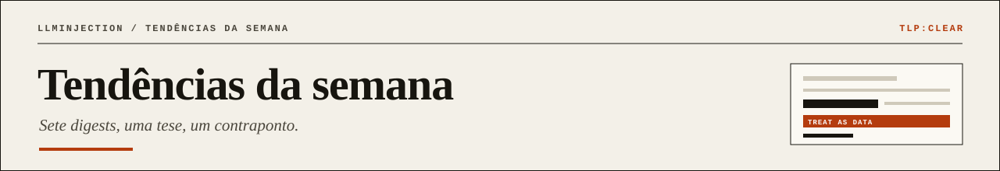

LLMI-TS-2026-W47TLP:CLEARCorte 2026-11-20 · janela 2026-11-14 a 2026-11-20

Primeira edição. Rascunho gerado por `scripts/build_weekly.py` a partir dos datasets e de 1 digest(s) diário(s) da janela. Os números e a lista de sinais são contados; as seções analíticas são escritas a partir desses sinais.

**O plano de controle de IA continua sendo o alvo: a semana fechou com o LiteLLM na quarta entrada do KEV, servidores MCP sem autenticação e o ARTEX dentro de um órgão europeu.**

10 sinais na semana; destaque: jupyter-mcp-server CVE-2026-77318: connect and stop endpoints without authentication.

## Números da semana

| Medida | Valor |
|---|---|
| Sinais (registros, KEV, digests) | 10 |
| Incidentes e campanhas novos nos datasets | 2 |
| Com framework ofensivo agêntico | 1 |
| Entradas novas no CISA KEV | 1 |
| Itens de digest diário | 7 |

## Sinais

| # | Data | Tipo | Sinal | Fonte | Item | Selo |
|---|---|---|---|---|---|---|
| 1 | 2026-11-20 | digest | jupyter-mcp-server CVE-2026-77318: connect and stop endpoints without authentication | [fonte](https://radar.offseq.com/threat/cve-2026-77318-cwe-306-missing-authentication-for-critical-functionality-in-datalayer-jupyter-mcp-74ebe06170f4e8e7) | `LLMI-20261120-03` | secundária |
| 2 | 2026-11-20 | digest | mssql-mcp SQL injection (CVE-2026-63129) and obsidian-sync-mcp DNS-rebinding write (CVE-2026-77283) | [fonte](https://cvebrief.com/archive/2026/11/19/) | `LLMI-20261120-04` | secundária |
| 3 | 2026-11-20 | digest | PISmith vs PIPETTE: repetitive automated prompt-injection red teaming weakens the trained defence | [fonte](https://www.helpnetsecurity.com/2026/11/20/ai-prompt-injection-red-team/) | `LLMI-20261120-01` | secundária |
| 4 | 2026-11-20 | digest | Symantec: autonomous LLMjacking agent observed against a honeypot | [fonte](https://www.infosecurity-magazine.com/news/symantec-ai-agent-llmjacking/) | `LLMI-20261120-06` | secundária |
| 5 | 2026-11-20 | digest | Viaconnect: indirect prompt injection through EDR telemetry against AI-assisted SOCs | [fonte](https://www.baguete.com.br/noticias/viaconnect-apresenta-pesquisa-sobre-ataques-a-socs-com-ia-em-evento-internacional) | `LLMI-20261120-07` | secundária |
| 6 | 2026-11-20 | digest | LiteLLM CVE-2026-40217: guardrail tester sandbox escape to root, reported added to CISA KEV | [fonte](https://labs.zenity.io/p/threat-actors-are-trying-to-use-litellm-s-guardrail-tester-to-run-code-as-root) | `LLMI-20261120-02` | secundária |
| 7 | 2026-11-20 | digest | GTIG: agentic threat activity crosses a significant threshold | [fonte](https://cloud.google.com/blog/topics/threat-intelligence/agentic-threat-activity-crosses-a-significant-threshold) | `LLMI-20261120-05` | lido no original |
| 8 | 2026-11-19 | incidente | European Commission staff systems disrupted; CERT-EU found ARTEX in use | [Cyber Security News](https://cybersecuritynews.com/european-commission-cyberattack/) | `INCIDENT-EC-ARTEX-2026-11` | registro do repositório · média |
| 9 | 2026-11-18 | incidente | Exploitation attempts against LiteLLM's guardrail tester (CVE-2026-40217) | [Zenity Labs](https://labs.zenity.io/p/threat-actors-are-trying-to-use-litellm-s-guardrail-tester-to-run-code-as-root) | `INCIDENT-LITELLM-GUARDRAIL-TESTER-EXPLOITATION` | registro do repositório · alta |
| 10 | 2026-11-18 | KEV | CVE-2026-40217 · litellm: LiteLLM guardrail tester sandbox escape to code execution | [GitHub Advisory Database](https://github.com/advisories/GHSA-wxxx-gvqv-xp7p) | `VULN-LITELLM-CVE-2026-40217` | catálogo CISA KEV |

## Técnicas e ferramentas que se mexeram

| Técnica | Sinais na semana |
|---|---|
| `LLMI-T024` Exposed or Misconfigured AI Services | 2 |
| `LLMI-T016` AI Gateway Credential Compromise | 1 |
| `LLMI-T015` Agentic Attack Orchestration | 1 |

**Ferramentas agênticas citadas:** ARTEX (1).

**Novas no KEV:** CVE-2026-40217 · litellm: LiteLLM guardrail tester sandbox escape to code execution (2026-11-18).

## O contraponto
O caso da Comissão Europeia ainda não mostra que o ARTEX abriu a porta: o relato não nomeia falha nem ator e não confirma exfiltração. E o estudo PISmith vs PIPETTE lembra que parte do ruído sobre injeção de prompt vem de laboratório: repetir a mesma técnica milhares de vezes enfraqueceu a defesa treinada, mas isso é resultado de benchmark, não de incidente.

## Segunda-feira do defensor
- **Uma detecção:** `DET-AI-056` (chamada a endpoint de teste ou de código de plataformas de IA) cobre o `/guardrails/test_custom_code` do LiteLLM; somada à `DET-AI-053` (serviço de IA gerando shell), pega a exploração do CVE-2026-40217 antes e depois do sucesso.
- **Uma hipótese de hunting:** hosts que rodam LiteLLM tiveram chamadas a `/guardrails/test_custom_code` seguidas de processo filho do proxy desde 18/11; procurar nos logs do proxy reverso e no EDR.
- **Um controle:** atualizar o LiteLLM para 1.83.10 ou superior e tirar da internet servidores MCP com endpoints sem autenticação (jupyter-mcp-server, CVE-2026-77318) e proteger contra DNS rebinding os que escutam localmente (obsidian-sync-mcp, CVE-2026-77283).

## Camada 8
O padrão humano da semana é a ferramenta de teste deixada em produção: o testador de guardrail do LiteLLM e os endpoints de conexão do servidor MCP existem para facilitar a vida de quem configura, e viram o primeiro alvo de quem varre. Do lado do SOC, o caso Viaconnect inverte o problema: o analista confia no resumo do assistente de IA, e é exatamente esse resumo que a injeção pela telemetria do EDR tenta controlar.

## Brasil e América Latina
Um sinal regional na semana: pesquisa brasileira apresentada pela Viaconnect mostrou a injeção indireta de prompt pela telemetria do EDR contra SOCs que usam assistente de IA (fonte secundária, imprensa brasileira; o material original não foi lido). Para os demais sinais, impacto regional não demonstrado nas fontes consultadas.

## Para acompanhar
- **Confirmaria a tendência:** o CERT-EU publicar o vetor de entrada na Comissão; novos CVEs de servidores MCP entrando no KEV.
- **Enfraqueceria:** a exploração do CVE-2026-40217 ficar restrita a tentativas, sem comprometimento confirmado, como descreve a Zenity até agora.

---

## Versão curta (LinkedIn)

10 sinais de ameaça a sistemas de IA na semana de 14/11 a 20/11.

- jupyter-mcp-server CVE-2026-77318: connect and stop endpoints without authentication
- mssql-mcp SQL injection (CVE-2026-63129) and obsidian-sync-mcp DNS-rebinding write (CVE-2026-77283)
- PISmith vs PIPETTE: repetitive automated prompt-injection red teaming weakens the trained defence

Relatório completo, fontes e grau de cada uma: https://ridd1kulusc0d3r.github.io/LLmInjection/#tab=reports

#CTI #SegurançaDeIA #ThreatIntel
